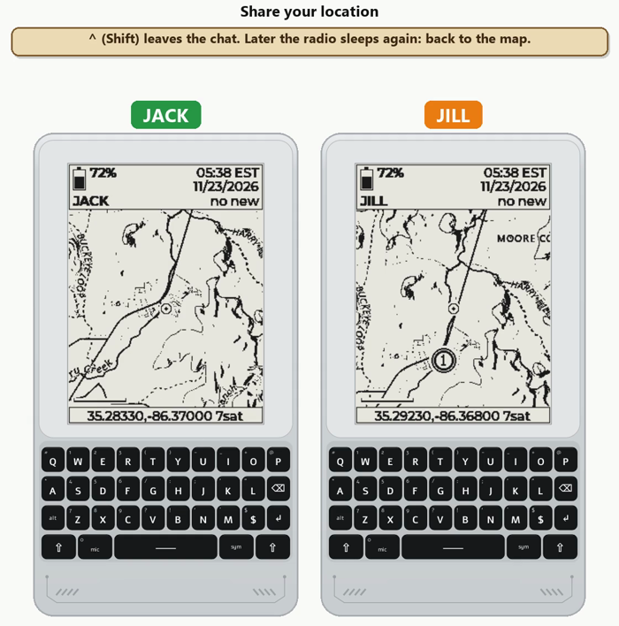
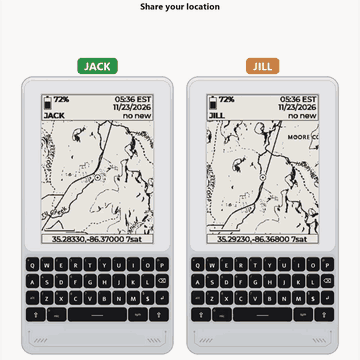
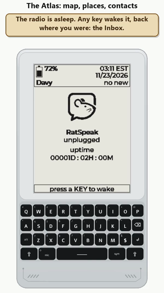
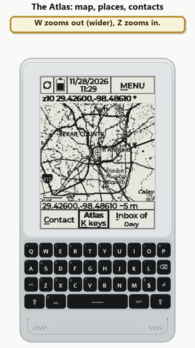
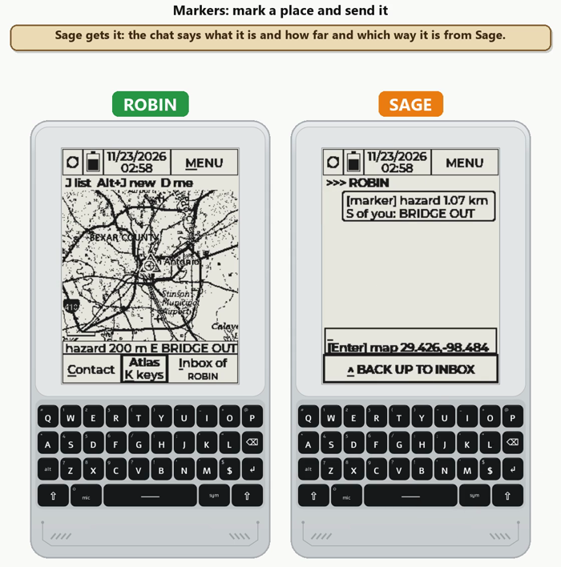
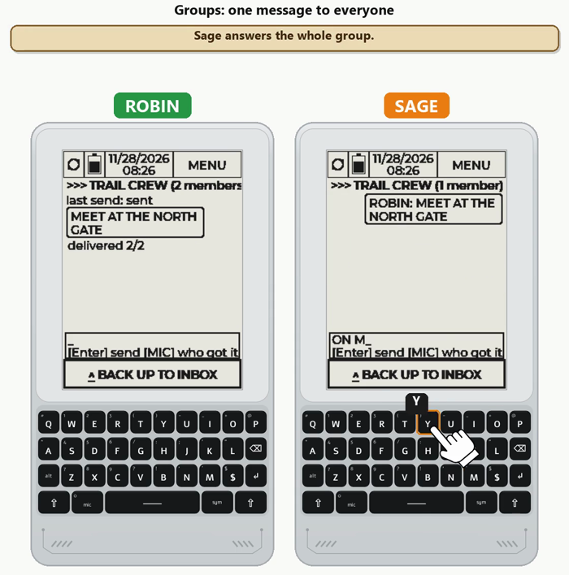
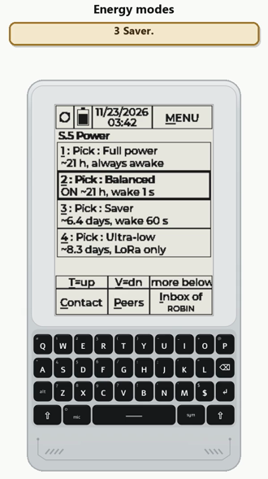

<div align="center">

# RatSpeak for the LilyGO T-Deck Pro

**An off-grid messenger for the T-Deck Pro: encrypted Reticulum / LXMF messages over LoRa,
offline topo maps, groups, location sharing and markers, on a keyboard and e-ink screen.**

[](#state)
[](LICENSE)



</div>

## What it is

RatSpeak turns a [LilyGO T-Deck Pro](https://lilygo.cc/) into a standalone radio messenger.
No phone, no account and no internet: units find each other over LoRa and talk directly,
end to end encrypted ([Reticulum](https://reticulum.network/) / LXMF, so Sideband and other
LXMF apps can talk to it too). Everything is driven from the keyboard, and the e-ink screen
stays readable in full sun and costs almost no power.

This is a fork of [Ratspeak Handheld](https://github.com/ratspeak/ratspeak-handheld)
(rsReticulumLite, rsLXMFLite) with a T-Deck Pro board and app of its own.

## Overview video

<a href="docs/videos/Overview.mp4"></a>

A 90-second tour ([Overview.mp4](docs/videos/Overview.mp4)): sharing a location, the Atlas,
markers, a group chat, the walkie-talkie, the Library and games, energy modes. Every feature
also has its own short how-to video ([docs/HowTo.md](docs/HowTo.md)).

## Features

| | |
|---|---|
|  | **Messages and contacts.** Chats with delivery status, an Inbox, contact cards you can swap over the air, Peers (every radio heard), announce. Messages also travel over WiFi between units on the same network. |
|  | **Atlas: offline topo maps** from the SD card (US topo, Canada, a world overview). Find a place by name, waypoints, a breadcrumb track and "track back", the heading and distance to a contact, arrival alerts. **O** switches map layers (names, contours, woods, hill shading ...) and a radio coverage overlay made by `tools/maptiles/rf_coverage.py` from elevation data. |
|  | **Markers (ATAK-style items of interest).** Mark a hazard, camp, water or meet-up with a short note, at the map cross or "200 m east of me", and send it to a contact or a group. The receiver sees *"hazard 1.07 km S of you: BRIDGE OUT"* and a triangle on the map. |
| | **SOS.** Hold the top button 3 s: after a 5 s countdown (any key cancels) the radio sends "SOS! ... needs help." with position and battery to your saved contacts or a group, then a position update every 2 minutes until you hold it again. A radio that gets one sounds a loud alarm, even in quiet hours. Quick replies (**MIC**, **Q**, a digit) send "On my way", "I'm safe" and the like in one key. |
|  | **Groups.** One message to up to 8 contacts. Share a group so the members have it too; anyone can answer the whole group. |
| | **Status sharing.** Send your position and battery % to a contact or a group, once or automatically (off by default; sends only when you moved 50 m or the battery changed by 5 points, plus a keep-alive). One-time shares also carry Sideband's telemetry field, and incoming telemetry (from Sideband too) puts the sender on the map. |
| | **ATAK feed.** The unit sends itself, its contacts' positions and the markers as Cursor-on-Target, and takes in what ATAK sends: ATAK users (squares) and their markers show on the Atlas. No TAK server needed. Two links to the phone: **WiFi** (multicast 239.2.3.1:6969 on the same network) or **Bluetooth** (paired and encrypted, no network at all, through the small Android app [RatSpeak ATAK bridge](tools/android/atak-bridge/README.md)). *(WiFi: a PC received every event as valid CoT. Bluetooth: simulator and radio side tested. Not yet seen with a real ATAK phone.)* |
|  | **Days on a charge.** Energy modes from Full power to Check-in (LoRa only at set times), standby when idle, a battery gauge with time left, a low-battery notice to a contact. The idle screen shows a splash, your "If found" details, or the map. |
|  | **And also:** password lock, walkie-talkie and voice messages over WiFi, Home Assistant voice (push-to-talk or a wake word, announcements, opt-in battery / position sensors), quiet hours, a Library of text files on the SD card where you can also write notes (with a frequency quick reference and the NOAA Weather Radio stations nearest you), games (Rat Trap, chess), SD backup and restore, firmware update from the SD card, a two-unit range test, a "Ready for a trip?" check, switch-off for storage with a daily contact window. |
| | **GPS you can see.** A position is used as soon as it is roughly right, with its level (good / fair / rough) and error; the last fix is kept across a restart and the receiver gets back what it learned about the satellites, so fixes come sooner. A live page shows every satellite's signal, and a field log writes a line a minute to the SD card for checking a drive or a walk afterwards. |

## State

Beta, on five test units and a desktop simulator (28 Nov 2026). The newest features (groups,
status sharing, markers, the ATAK feed) pass their simulator tests; on real radios a marker
and status updates went through, while larger multi-unit runs are still in progress (see
[Stress_test_plan.md](Stress_test_plan.md)). For testing, radios can send their console over
WiFi to a relay (`tools/netcon`), at home or through a phone hotspot. Expect changes in menus
and storage formats.

## Hardware

LilyGO T-Deck Pro: ESP32-S3 with 16 MB flash and PSRAM, 3.1" e-ink (240 x 320), keyboard,
touch screen, SX1262 LoRa (915 MHz builds here), GPS, battery gauge and charger, microSD.
A microSD card is optional for messaging and needed for maps and the Library.

## Install

From a PC with Python 3 and `esptool` (`pip install esptool`), the unit on USB:

```bash
python tools/flash_new_device.py COM7          # a new unit (or --erase: settings, identity and messages are wiped)
python tools/flash_app.py COM7                 # a unit that already runs RatSpeak: the app only, data kept
```

The image is in [`firmware/`](firmware/) (`tdeck_pro_standalone.bin`; the `.txt` beside it
names the source commit and sha256). If a unit does not answer: hold the top side button,
press and release the bottom one, let go, and run the command again. The first start opens
a short setup wizard. Maps go on the SD card: see [tools/maptiles](tools/maptiles/README.md).

## Documents

| | |
|---|---|
| [docs/User_Manual.md](docs/User_Manual.md) ([PDF](docs/User_Manual.pdf)) | The user manual: install, first start, every feature, Settings reference, troubleshooting, limits |
| [docs/HowTo.md](docs/HowTo.md) | Step-by-step guides, each with a video ([docs/videos](docs/videos)) |
| [RatSpeak_TDeck-Pro_Description.md](src/boards/tdeck_Pro/RatSpeak_TDeck-Pro_Description.md) | The full description: every screen, key and setting |
| [docs/sharing_atak_report.md](docs/sharing_atak_report.md) | Status sharing, markers and the ATAK feed: design, tests, open questions |
| [docs/groups_report.md](docs/groups_report.md) | Groups |
| [docs/standby_mode_report.md](docs/standby_mode_report.md) | Standby when idle, the lock button |
| [Stress_test_plan.md](Stress_test_plan.md) | How the firmware is stress tested, and the results |
| [sim/README.md](sim/README.md) | The desktop simulator, which runs the real firmware |
| [docs/videos/Video_Descriptions.txt](docs/videos/Video_Descriptions.txt) | The scripts behind the how-to videos |
| [Future_steps.txt](Future_steps.txt) | Planned work |

## Build and test

- **Firmware:** PlatformIO, environment `tdeck_pro_standalone`
  (`pio run -e tdeck_pro_standalone`). On this project's build VM:
  `python tools/vm_build.py --commit` builds it and commits the image to `firmware/`.
- **Simulator** (Windows, Qt 6): runs the unchanged firmware in a window drawn like the
  device, several at once on a simulated LoRa channel. Build and use: [sim/README.md](sim/README.md).
- **Tests:** screen scripts in `sim/scripts/*.txt` and multi-radio tests such as
  `marks_net.py`, `cot_net.py`, `groups_net.py`, `status_net.py`; random-key stress
  `tools/stress/monkey.py`.
- **Videos:** `tools/howto/make_videos.ps1` records every how-to video from
  `sim/scripts/howto/` on the simulator.

The upstream build for the other handhelds (T-Deck Plus, T-Pager, Cardputer Adv,
ThinkNode M9: `make setup DEVICE=tdeck`, `make package`) is still in the tree; see
[Ratspeak Handheld](https://github.com/ratspeak/ratspeak-handheld) for those.

## License

GNU Affero General Public License v3.0 or later. See [LICENSE](LICENSE).
Bundled RNode firmware keeps its [GPLv3 license](vendor/rnode_firmware/LICENSE).
See [Third-party notices](THIRD_PARTY_NOTICES.md) and [CONTRIBUTORS.md](CONTRIBUTORS.md).
