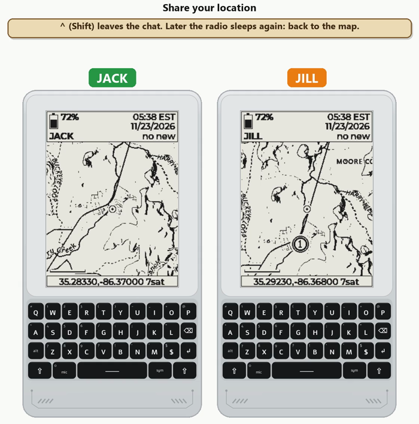
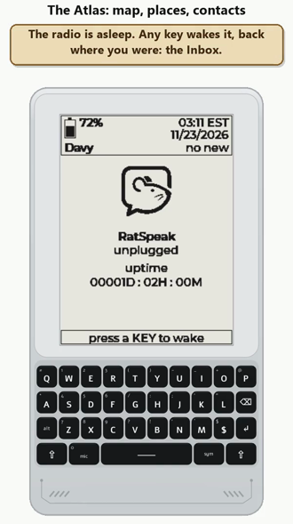
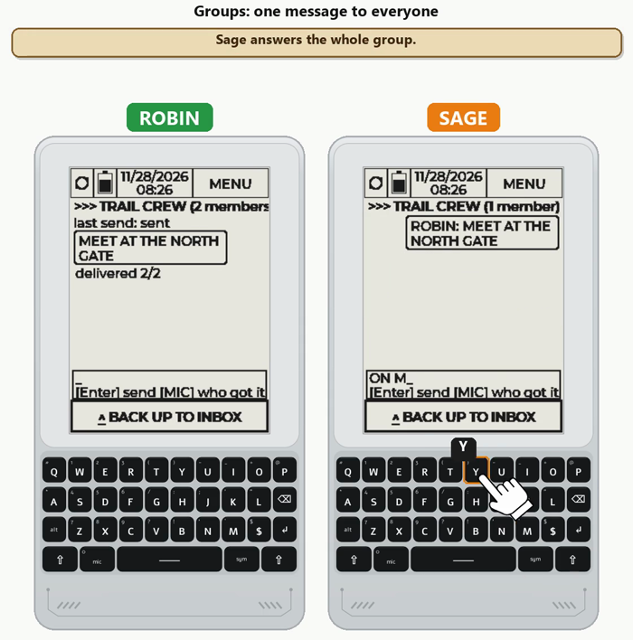
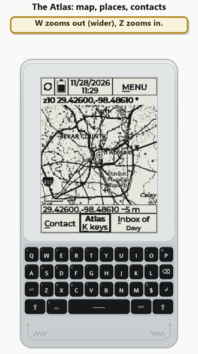
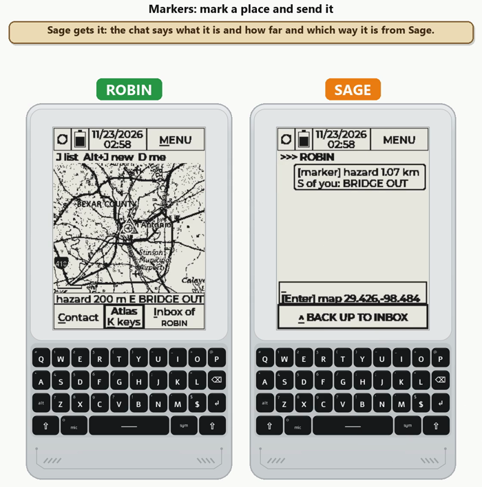
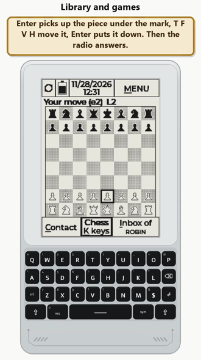
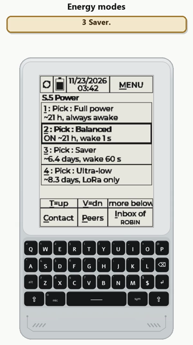

# RatSpeak for the LilyGO T-Deck Pro: User Manual

Firmware as of 23 November 2026 (beta). Keys, menus and limits in this manual are taken from
the firmware source. Where a feature has only been tested in the desktop simulator, it says
so.



**Contents**

1. [What it is and what you need](#1-what-it-is-and-what-you-need)
2. [Install](#2-install)
3. [The basics](#3-the-basics)
4. [Using the radio](#4-using-the-radio)
5. [Settings reference](#5-settings-reference)
6. [Battery, charging and energy modes](#6-battery-charging-and-energy-modes)
7. [Troubleshooting and questions](#7-troubleshooting-and-questions)
8. [Specifications and limits](#8-specifications-and-limits)
9. [Radio use and safety](#9-radio-use-and-safety)
10. [Videos](#10-videos)

---

## 1. What it is and what you need

RatSpeak turns a LilyGO T-Deck Pro into a radio messenger that works with no phone, no
account and no internet. Radios find each other over LoRa and send messages directly to each
other, end-to-end encrypted. It uses Reticulum and LXMF, so Sideband, MeshChat and other LXMF
apps can message a RatSpeak radio too.

Everything works from the keyboard. The e-ink screen is easy to read in full sun and uses
almost no power. It keeps its picture even when the battery is flat.

**What you need**

| Item | Needed for |
|---|---|
| LilyGO T-Deck Pro (ESP32-S3, 16 MB flash, PSRAM, SX1262 LoRa, GPS, e-ink, keyboard) | everything |
| LoRa antenna, fitted | sending. Never transmit without an antenna |
| USB-C cable that carries data | installing the firmware, charging |
| A PC with Python 3 (Windows, macOS or Linux) | installing the firmware |
| microSD card, FAT32 | optional: maps (Atlas), Library, notes, backups, firmware updates from the card |
| A second RatSpeak radio, or a phone with Sideband | someone to talk to |

The builds in this repository are for **915 MHz**. Use the band that is legal where you are
(see [section 9](#9-radio-use-and-safety)).

---

## 2. Install

### 2.1 Put the firmware on the radio

The firmware image is `firmware/tdeck_pro_standalone.bin` in this repository. The `.txt` file
next to it names the source commit and the image's sha256.

On the PC, once:

```bash
pip install esptool pyserial
```

Plug the radio into the PC with the USB-C cable. Find its serial port (Windows: Device
Manager, Ports, for example `COM7`; Linux: `/dev/ttyACM0`; macOS: `/dev/cu.usbmodem…`).

**A new radio** (or one that ran other firmware):

```bash
python tools/flash_new_device.py COM7
```

This writes the bootloader, the partition table and the app, then waits for the radio to
start and prints its address. A new radio then opens the setup wizard
([2.3](#23-first-start-the-setup-wizard)).

**A radio that already runs RatSpeak** (an update; messages, contacts and settings are kept):

```bash
python tools/flash_app.py COM7
```

**Start again from nothing** (settings, identity and messages are deleted):

```bash
python tools/flash_new_device.py --erase COM7
```

Other options: several ports at once (`flash_new_device.py COM7 COM10`), every port
(`--all`), or `--dry-run` to see what would be written.

**If the radio does not answer:** hold the **top** side button, press and release the
**bottom** side button, then let go of the top one. The radio is now in the chip's USB
download mode. Run the command again. After flashing, press the bottom button (or unplug and
plug in again) to start it.

Later updates can also be done from the SD card without a PC: see
[4.21](#421-update-the-firmware-from-the-sd-card).

> A web flasher in the browser is planned for new owners (described in the
> out-of-box video script). It has not been checked yet; use the Python tools above.

### 2.2 Prepare the SD card (optional)

Messaging needs no card. The card holds:

| Folder on the card | What |
|---|---|
| `ratdeckpro/maps/` | Offline map tiles for the Atlas. Without them the menu has no Atlas |
| `ratdeckpro/library/` | Text files for the Library: the help pages, a frequency reference, NOAA Weather Radio stations, your notes |
| `ratdeckpro/contacts.txt` | Contacts to import (one `name<TAB>32-hex-address` per line) |
| `ratdeckpro/tracks/` | Breadcrumb tracks exported as GPX |
| `firmware/` | A firmware `.bin` for updating from the card |
| backups | Made by "Back up now" |

- **Maps:** made on a PC with the scripts in `tools/maptiles/` (see
  [tools/maptiles/README.md](../tools/maptiles/README.md)). Copy the `ratdeckpro` folder to
  the root of a FAT32 card. You can also send files to the card in the radio over USB with
  `tools/sdcard/push_files.py` (the radio must be unlocked).
- **Library:** copy `tools/sdcard/library/*` into `ratdeckpro/library/` on the card.
- Use a card that FAT32 can format. A 32 GB card has been used on the test units.

### 2.3 First start: the setup wizard

A new radio opens the setup wizard at its first start. The top line reads **Setup 1/10**
and so on. **Enter** keeps what is shown and goes on, **^** goes back, a number picks a row,
**0** (hold **SYM**, press **MIC**) skips the rest.

| Step | What you choose |
|---|---|
| 1 | Welcome (what RatSpeak is, the keys) |
| 2 | Radio name (default TDP- plus four characters) |
| 3 | Time zone. The clock sets itself from GPS or from radios it hears |
| 4 | Clock: 24 h or 12 h |
| 5 | Energy mode: Full, Balanced (default), Eco, Saver, Check-in |
| 6 | Idle screen: Splash, Map, Library page, If found |
| 7 | Minimal, Typical or Everything |
| 8 | Password lock: none, or set one |
| 9 | Import contacts: listen over the radio, or read `ratdeckpro/contacts.txt` from the card |
| 10 | Done. **Enter** announces the radio and finishes |

Everything can be changed later in Settings. To run the wizard again: **M**, **S**, **7**
(Identity), row 6.

Then meet another radio: announce on both ([4.3](#43-contacts-and-announce)) and send a test
message.

### 2.4 Calibrate the battery (once)

On a new radio the battery % is only a rough guess (one unit showed 62 % when it was full).

1. Charge it full: leave it on a charger until the Battery page (**M**, **S**, **6**) says
   full. Use a wall charger or a PC port that really charges.
2. Unplug it and use it until it switches itself off ("BATTERY EMPTY / PLUG IN A USB
   CHARGER" on the idle screen). Do not top it up part way.
3. Charge it full again.

After this the % and the time left are much more accurate. Do it again if the % starts to
look wrong. Battery page row 10 resets the calibration.

---

## 3. The basics

### 3.1 Buttons and keys

| Control | What it does |
|---|---|
| **Top side button**, short press | Locks the radio and shows the idle screen (with no password: just the idle screen). Acts when you let go |
| **Top side button**, held 3 s | SOS ([4.7](#47-sos)). Can be turned off: Alerts row 8 |
| **Top side button**, held 2 s while the screen says SWITCHED OFF | Switches the radio on ([section 6](#6-battery-charging-and-energy-modes)) |
| **Bottom side button** | Restarts the radio (a radio that is switched off stays off) |
| **Top + bottom** (hold top, tap bottom, let go of top) | USB download mode, for installing firmware |

| Key | Does |
|---|---|
| **M** | Menu: **H** Home, **S** Settings, **C** Contacts, **P** Peers, **I** Inbox, **A** Atlas, **R** Library |
| **I** | Inbox (your chats) |
| **C** | Contacts. **G** on Contacts = Groups |
| **P** | Peers (every radio heard). **R** on Peers = announce this radio |
| **A** | Atlas, the offline map |
| **T** / **V** | Up / down in lists |
| **N** / **B** | Next / previous page of a long list |
| **L** | Find: in a list (type to filter), a place on the map, a word in a Library file |
| **K** | The keys card on the Atlas, in the Library and in the games |
| **Enter** | Open, send, save |
| **^** (Shift tapped alone) | Back |
| **Alt** + key | Small letter (the keyboard types capitals) |
| **SYM** held + key | Digits and symbols: **W E R** = 1 2 3, **S D F** = 4 5 6, **Z X C** = 7 8 9, **MIC** = 0 |
| **MIC** | Full screen refresh. In a chat: the chat menu. With Home Assistant voice on: talk to Home Assistant |

There is no S key on its own: Settings is always **M**, then **S**.

Numbers pick rows. In Settings a number opens that row at once (**0** = row 10; rows after
10: **T** / **V** to them, then **Enter**). In lists a number selects the row and **Enter**
opens it.

While you type, letter keys type letters. Press **^** first to use them as keys again.

### 3.2 The screen

- **Top bar:** at the top left a refresh button (the circle; tap it for a full refresh), the
  battery, the date and time, and **MENU**.
- **Bottom tabs:** Contact, the middle tab (where you are, and "K keys" where there is a
  keys card), Inbox.
- **e-ink:** pictures are drawn with quick partial refreshes. A faint shadow of the last
  screen ("ghosting") can stay. **MIC** or the refresh button clears it with a full refresh.

### 3.3 Idle screen and waking up

After a while without a key the radio shows its idle screen and sleeps. Any key wakes it;
that key does nothing else. Touch does not wake it.

Every idle screen has the battery %, the time left, the time and date, the radio's name and
the number of new messages ("3 NEW") at the top. Pick which one: **M**, **S**, **4**
(Screen & I/O), **2** (Idle splash), row 8:

- **Splash:** logo, power, uptime.
- **Map:** the map around you with your contacts.
- **Library page:** the page you last read.
- **If found:** "IF FOUND, PLEASE RETURN TO:" with your details (row 9) and the radio's
  address. It stays readable even with a flat battery.

### 3.4 Password lock

**M**, **S**, **4**, **2**, then:

- **3** On + password: type a new password (4 to 32 characters), **Enter**, the same again,
  **Enter**. **MIC** shows or hides what you type.
- **5** Change password, **6** Remove password, **7** Lock now (or the top side button).

Locked: any key shows the password prompt. Messages still arrive. 3 wrong tries are free, then
you wait 30 s, 60 s and longer, up to 16 minutes. With a password set the radio also locks at
every start, and saved WiFi passwords stay sealed until it is typed.

**Write the password down.** It cannot be read back, and the radio cannot be unlocked
without it ([7](#7-troubleshooting-and-questions)).

### 3.5 Mode: Minimal, Typical, Everything

**M**, **S**, **1**:

- **1 Minimal:** only Inbox, Contacts, Settings row 1 and the walkie-talkie. The radio wakes to
  the Inbox. Home, Switch off, the trip check and the map are not in Minimal: they are in
  Typical and Everything. To get back: **M**, **S**, **1**, **2**.
- **2 Typical:** the features turned on in row 5. Unless "Advanced" is on there, the Power
  page shows only Full, Balanced, Eco and Saver (plus the mode in use), Full power on USB
  and Switch off; Ultra-low, On demand, Check-in, Custom, the energy monitor and standby
  are in Everything.
- **3 Everything:** all features.
- **4** Touch screen on / off (off = keys only).
- **5** Typical features: Walkie-talkie, Voice messages, Home Assistant voice, WiFi settings,
  Atlas (maps), Library & games, Peers & announce, Advanced (LoRa, diagnostics).

### 3.6 Energy modes in short

**M**, **S**, **5** (Power). Balanced is the everyday mode. Keys and incoming messages work at
once in every mode except On demand and Check-in. Details in
[section 6](#6-battery-charging-and-energy-modes).

---

## 4. Using the radio

### 4.1 Send and read messages



**Send**

1. **I** (Inbox). Pick the chat with **T** / **V**, or hold **SYM** and type its number.
2. **Enter** opens it.
3. Type (up to 120 characters). The typing box grows to three lines.
4. **Enter** sends. "delivered" shows when the other radio has it.
5. **^** back to the list.

If the other radio is out of range, the message waits in a queue and goes out by itself when
that radio is heard again.

**Read:** the idle screen shows "1 NEW". Wake it, **I**, pick the marked chat, **Enter**.
The newest message is at the bottom; **T** / **V** scroll.

Long lists (up to 48 rows) show in pages: **N** / **B** next / previous page, **L** find.

### 4.2 Quick replies

In a chat, **MIC** then **Q** shows eight short answers:

1 OK · 2 Yes · 3 No · 4 On my way · 5 Where are you? · 6 Call me · 7 I'm safe · 8 Wait for me

Its number sends it at once. Any other key closes the list. Works in group chats too.

### 4.3 Contacts and announce

A new radio is not saved by itself: you save it by giving it a name.

1. Both radios announce once: **M**, **H** (Home), **N** (Announce ID). Or **P**, then **R**.
2. **P** (Peers): every radio heard, with its signal and how long ago.
3. Pick the new radio, **Enter**: its page (**1** Message, **2** Rename, **3** Share,
   **4** Map number).
4. **2**, type a name, **Enter**. It is now in Contacts (**C**). Peers marks saved radios
   with \*.

Your own radio is row 0 (MyID) in Contacts. Rename it the same way.

Announce when you meet someone new or when others cannot find you. It is not needed for each
message.

### 4.4 Swap contact cards

1. **C**, row 0 (MyID) for your own card, or any contact, **Enter**.
2. **3** (Share). The list reads "Send *name* to:". Pick who gets it, **Enter**. **P**
   switches to Peers for someone who is not a contact yet.

The other radio shows **[card] name** in the chat; **Enter** on the empty message line saves
it. Other LXMF apps see "Contact card: name" and the address.

All contacts to one radio at once: **M**, **S**, **7**, row 7 (Share all contacts). Export
or import them through the SD card: rows 8 and 9.

### 4.5 Groups



A group is a name and up to 8 of your contacts. A message to the group goes to every member,
one after the other (about 4 seconds each on LoRa).

- **Make one:** **C**, **G**, **New group** (or **N**), type a name (up to 16 letters),
  **Enter**. **Enter** on a contact puts it in (**[x]**) or takes it out. **^** when done.
- **Send:** **C**, **G**, the group, **Enter**, **1**. Groups are also the first rows of the
  Inbox. Under your message: "2/3 delivered", "1 to send", "1 no reply". **MIC** shows who
  got it.
- **Give the group to its members:** the group's page, **4** (Share), pick a member,
  **Enter**; once per member. On their radio **Enter** on the empty message line joins it.
  Until then your group messages show in their chat with you, marked **[GROUP NAME]**.
- **Change:** **2** Members, **3** Rename, **5** Delete (press twice). Share again to update
  the others.

Up to 8 groups. Other LXMF apps show a group message as a normal message from you.

### 4.6 Share your location and battery

Nothing about where you are, or your battery, is sent unless you send it.

1. Open the chat, **MIC**: the share menu.
2. **1** sends your position and battery once. **B** changes what is sent: position and
   battery, position only, battery only.
3. **2** Auto-share: every 5, 15, 30, 60 minutes, off. Row 3: for how long. The chat's top
   line shows **[loc+bat 5m]** while it is on.
4. To a group: open the group chat, **MIC**, **L**.
5. Stop all sharing: **M**, **S**, **2**, row 8.

Auto-share only sends when you moved more than 50 m or the battery changed by 5 points, and
otherwise every second interval. Without a GPS fix the battery goes alone.

The other radio shows **[loc]** or **[bat]**; **Enter** on the empty message line opens the
map there. Your position shows on their Atlas. Sideband gets one-time shares as telemetry too,
and Sideband's telemetry puts its sender on the RatSpeak map.

**Low-battery notice:** **M**, **S**, **6**, row 12. Pick the % and the contact. Once per
discharge they get your battery % and last position. Off by default.

### 4.7 SOS

1. Hold the **top side button** for 3 seconds.
2. The radio buzzes and counts down: "SOS in 5 s, a key cancels". Any key or a short press of
   the button stops it. Nothing is sent.
3. After 5 seconds it sends "SOS! *your name* needs help." with your position (GPS, the last
   fix or the saved position) and battery.
4. Then a position update every 2 minutes and the full SOS every 10 minutes, also after a
   restart.
5. Hold the top button 3 seconds again to end it. "SOS cancelled" is sent.

**Who gets it:** all saved contacts (at most 8), or one group. **M**, **S**, **9** (Alerts),
row 7 "SOS sends to": **Enter** steps through them.

**Turn the SOS button off:** Alerts row 8 "SOS button (hold 3 s)". When it is off, a long hold
is just a press (it locks). A running SOS can still be ended with a hold.

**Receiving an SOS:** the radio wakes and sounds a loud alarm every 3 seconds for a minute,
even in quiet hours or with the beep off. Any key silences it. The sender shows on the map at
the position in the SOS.

An SOS goes to the front of the send queue, and a newer position replaces one still waiting.
In Check-in mode the radio turns LoRa on for the SOS instead of waiting for the next window,
and goes back to Check-in once "SOS cancelled" is sent. Over LoRa an SOS to 8 contacts still
takes a while to reach them all; a radio that is out of range gets it when it is heard
again. *Tested on the simulator; on real radios the update, the cancel and quick replies
arrived, and the first SOS reached the receivers late, which the queue change above
addresses (23 Nov 2026).*

### 4.8 The Atlas (offline map)



Needs map files on the SD card ([2.2](#22-prepare-the-sd-card-optional)).

| Key | On the Atlas |
|---|---|
| **A** | Open it (on a list row of someone with a known position: at that person) |
| **T F V H** | Move up, left, down, right |
| **Z** / **W** | Zoom in / out |
| **D** or **Enter** | Back to your own position |
| **K** | The card with all map keys |
| **L** | Find a place by name; its number jumps there |
| **G** | Heading and distance to the selected place or contact (a big arrow) |
| **N** | Step through your contacts' last positions, newest first |
| **P** | Step through your waypoints. **Alt+P** saves one |
| **B** | Track back along your breadcrumb track |
| **J** | Markers. **Alt+J** = a new marker at the map cross |
| **O** | Map layers |
| **I**, **C** or **^** | Leave the map |

North is at the top. The radio has no compass: use the direction with a landmark, the sun
or a compass.

**Map layers (O):** turn layers on or off by their number (for example place names,
contours, woods, hill shading, and a radio coverage overlay made by
`tools/maptiles/rf_coverage.py`). **^** goes back to the map.

**Waypoints:** bring the place to the middle, **Alt+P**, type a name, **Enter**. **P** steps
through them; **Alt+SYM** twice removes the selected one. The list: **M**, **S**, **2**,
row 9. Up to 32.

**Home point:** one saved place the arrow can always point to. Set it with **M**, **S**, **2**,
row 14 (Set Home here: your position now) or row 15 (Set Home = map centre: move or search
the map to the place first), **Enter** twice. Then row 13 (Go Home), or on the map **G** with
nothing selected, or **Alt+H**, shows a big arrow, the distance and the compass direction.
While you walk the arrow is relative to your direction of travel; standing still it is
north-up. The idle screen shows "Home 212 mi NE". Row 16 on the same page shows sunrise and
sunset today at your position (good to a minute or two).

**Route points from a computer:** plan a route in any mapping program, save it as GPX with
waypoints or route points, and copy the file to the SD card folder `ratdeckpro/routes/`.
Then **M**, **S**, **2**, row 10 (Track), row 5 "Import route points". Each point becomes a
waypoint with its name (up to 32 in all). On the map **P** steps to the next one and **G**
shows the arrow and distance to it. Recorded tracks inside the file are not imported.

**Breadcrumb track:** **M**, **S**, **2**, row 10 (Track), **1** (Record track). A point about
every 25 m, drawn as a dotted line. **B** on the Atlas guides you back. The Track page also
exports it as GPX to the card and clears it (**Enter** twice).

**Navigate to a contact:** **N** until it is selected, **G** for the arrow, the distance and
how old their position is.

**Arrival alerts:** **M**, **S**, **9**, **5**, **1** (New alert). Pick the contact, near
whom or where (you or a waypoint), within what distance, once or every time. **5** saves.
Up to 8. The contact must be sharing their location with you.

### 4.9 Markers (items of interest)



A marker is a place with a type (hazard, person, vehicle, camp, water, meet-up, other) and a
note of up to 23 characters.

1. **A**, **J**: the marker list, nearest first. The last row is **New marker**.
2. The form: **1** type, **2** where (your position or the map cross), **3** distance,
   **4** direction, **5** note, **6** save.
3. On a marker: **1** show it on the map (a triangle), **2** send it to a contact or group,
   **3** twice removes it.

A marker you get shows in the chat as "[marker] hazard 640 m NE of you: bridge out".
**Enter** on the empty message line opens the map on it. The same marker sent again updates
it instead of adding a copy. **J** in the marker list shows the contacts with a shared
position, nearest first.

Up to 24 markers. When the list is full a new one replaces the oldest received one.

### 4.10 ATAK feed

Phones running ATAK (or WinTAK, iTAK) can see this radio, its contacts' shared positions
and the markers, with no TAK server. LoRa carries them between radios. Only the last few
metres, from the radio to the phone, go over WiFi or Bluetooth.

Turn it on: **M**, **S**, **3** (WiFi), row 9 "ATAK feed (CoT)", **Enter**. Every 30 s the
radio sends Cursor-on-Target events and takes in what ATAK sends: ATAK users show as squares
on the Atlas (up to 16), and their markers as markers from ATAK (at most 12 of the 24).

Row 10 "ATAK link to phone" chooses how (**Enter** switches; switching to Bluetooth restarts
the radio once):

| Link | Needs | Notes |
|---|---|---|
| **WiFi** (default) | radio and phone on the same WiFi network (a phone hotspot works) | Multicast 239.2.3.1:6969, ATAK finds it with no setup. Not encrypted. |
| **Bluetooth** | the *RatSpeak ATAK bridge* app on the phone (Android) | No network at all. Paired and encrypted. WiFi stays off while it runs. |

**Bluetooth, first time:**
1. On the radio: feed ON, link Bluetooth. Row 11 "Bluetooth" shows the radio's name
   (RatSpeak-xxxx) and a 6-digit PIN.
2. On the phone: install `firmware/RatSpeak-ATAK-bridge.apk` (allow installing from this
   source when Android asks). Open it, allow Bluetooth (Nearby devices), tap **Scan for
   radios**, tap the radio.
3. Android asks for a pairing code: type the code from the radio (it also pops up on the
   radio's screen for 30 s).
4. The app shows "connected to RatSpeak-xxxx"; ATAK shows the radio and its contacts. Later the
   phone reconnects by itself while the app runs.

For your own ATAK markers to reach the radio, add an output in ATAK once: Settings, Network
Preferences, Manage Outputs, address 127.0.0.1, port 4349, UDP. Your ATAK position reaches it
without that. To forget paired phones: row 11, **Enter** twice.

Either link keeps the radio awake (no light sleep): expect about 13 hours of battery with the
feed on (measured with WiFi), not days.

On the radio, the Library page *Help-15-Phone-link* compares WiFi and Bluetooth (who should use
which, battery, phone and ATAK set-up, trouble-shooting).

*Tested: WiFi with a PC receiving every event as valid CoT; Bluetooth in the simulator and the
radio side on a T-Deck Pro. Not yet seen with a real ATAK phone.* Windows PCs on a network
marked "Public" may block the WiFi feed. Video: [ATAK_over_Bluetooth.mp4](videos/ATAK_over_Bluetooth.mp4).

### 4.11 WiFi

WiFi is optional; messages go over LoRa without it.

1. **M**, **S**, **3** (WiFi), **3** (Scan networks).
2. Pick your network by its number, type the password (**Alt** small letters, **SYM**
   digits), **Enter**.
3. "connected" shows. The radio joins it again by itself.

Up to 8 saved networks (row 4), passwords stored encrypted. Row 5 disconnects. On WiFi,
RatSpeak radios on the same network also talk to each other directly (row 8, Mesh over WiFi,
on by default). Eco, Saver, Ultra-low, On demand and Check-in turn WiFi off.

### 4.12 Walkie-talkie

Talk live with another RatSpeak radio, over WiFi.

1. **C**, pick the person, **Enter**, **W** (call).
2. On the same WiFi the call uses it. Without WiFi your radio makes a small hotspot and the
   invite goes over LoRa; the other radio must then be within WiFi range (roughly 50 to 100 m
   in the open).
3. The other side answers with **Enter** (**^** declines). An unanswered call ends after
   60 s.
4. **Space** = talk, **Space** again = listen. One side talks at a time. **^** hangs up.

### 4.13 Voice messages

1. Open the chat, **MIC**, **5** (Voice message).
2. **Space** starts recording, **Space** again stops and sends (up to 20 s). **^** cancels.
3. To listen: **MIC**, **5**, **P** plays the newest one.

A voice message is bigger than one LoRa packet: it can take 10 to 30 s on LoRa, less on WiFi.
Sideband and other LXMF apps can play it.

### 4.14 Home Assistant voice

The radio can be a voice device for Home Assistant over WiFi (it looks like an ESPHome voice
device).

**On the radio:** join your WiFi, then **M**, **S**, **3**, row 7 (Home Assistant voice):

1. Voice for Home Assistant: **Enter** turns it on. The first time it makes an encryption key.
2. and 3. The 44-character key. 4. New random key. 5. No encryption (not recommended).
6. The name and port (6053) Home Assistant sees.
7. Wake word: Off (MIC to talk, default), On USB power only, Always.
8. Sensors for HA: Off (default), Battery, Battery + position.

**In Home Assistant (once):** Settings, Devices & services: configure the new ESPHome device
(or add it by the radio's IP address and port 6053), type the key, and pick the Assist
pipeline.

**Talk:** press **MIC**, speak, pause. The answer plays on the speaker and shows at the bottom.
With the wake word on, Home Assistant listens for it (it needs a wake word engine such as
openWakeWord). "Always" keeps WiFi and the microphone on: the battery lasts hours, not days.

**Announcements** from Home Assistant show as text with a chime (no chime in quiet hours).

While Home Assistant is connected the radio does not sleep. Turn it off when you do not need
it.

### 4.15 Relay mode

A radio can pass on messages for others over LoRa (a Reticulum transport node), to reach
radios further away. **M**, **S**, **8** (LoRa), row 7 "Relay for others": Off (default), On
USB power, Always. "Always" uses more battery. *Tested in the simulator; a test on real
radios placed apart is still to do.*

### 4.16 Library, notes and games



1. **M**, **R** (Library): the text files on the SD card.
2. A file's number opens it. **Space** or **N** next page, **B** back a page, **T** / **V**
   half a page, **W** wrap on / off, **L** find a word, **K** all reader keys, **^** back.
3. **New note** (last rows): type the note, **Enter** saves it on the card as
   Note-*date*-*time*.txt. It then opens like any other file.
4. Games: **Rat Trap** (**T F V H** move, **D** or **Enter** opens a square, **Alt+P** marks
   a trap, **Q** new game) and **Chess** (**Enter** picks up and puts down a piece, **U**
   takes a move back, **L** sets the level).

The Library holds up to 24 files. The help pages (Help-1 to Help-13) cover the same ground as
this manual in short.

### 4.17 Alerts and quiet hours

**M**, **S**, **9** (Alerts): beep, vibrate, volume (0 to 100 %, default 80), test alert,
arrival alerts, quiet hours, SOS. Quiet hours (row 6): 22-07, 23-06, 21-07, 20-08 or off.
Messages still arrive in quiet hours, without sound or vibration. An SOS alarm still sounds.

### 4.18 Range test

**M**, **S**, **8** (LoRa), **6** (Range test), pick the other radio, **Enter**. The screen
counts the pings that came back, with signal strength and quality, and the lost ones. With a
card in, each ping is also logged to a file. **^** stops it. (In Typical mode turn the
Advanced feature on first.)

### 4.19 Back up and restore

1. **M**, **S**, row 11 (Storage, **V** down to it, **Enter**), **5** (SD card).
2. **8** Back up now: messages, contacts, settings and your identity go to the card.
3. **9** Restore backup: **Enter** twice on one. The radio restarts as it was then.

Keep the card safe: whoever has the backup can pretend to be your radio.

**Message archive** (SD card page, row 6, off by default): every new message is also written
to the card.

### 4.20 Identities

**M**, **S**, **7**, row 5 (Identities): make a new identity (a new address), switch between
saved ones, or erase one. Each step asks for **Enter** twice and restarts the radio.

### 4.21 Update the firmware from the SD card

1. On a PC copy the new `.bin` into the folder `firmware` on the card.
2. Battery 30 % or more, or on a charger. **M**, **S**, Storage, **5** (SD card), **0**
   (row 10, Update firmware), **Enter** again.
3. About half a minute, then it restarts. Do not switch it off meanwhile.

If the new firmware does not start properly, the radio goes back to the old one by itself.

---

## 5. Settings reference

**M**, then **S**. A row's number opens it (**0** = row 10; later rows: **T** / **V**, then
**Enter**). Kinds: Menu (opens a page), Toggle, Pick (**Enter** steps to the next value),
Entry (type a value), Action, Info. Rows a mode hides keep their numbers.

| # | Page | Rows |
|---|---|---|
| 1 | **Mode** | 1 Minimal · 2 Typical · 3 Everything · 4 Touch screen · 5 Typical features |
| 2 | **Time & Location** | 1 Set RTC · 2 Time zone · 3 Enable GPS · 4 Manual location · 5 Sync GPS now · 6 Auto GPS sync (boot + daily) · 7 GPS position · 8 Location auto-share (stop all) · 9 Waypoints · 10 Track (breadcrumbs) · 11 Units (m/km or ft/mi) · 12 Coordinates (decimal, deg min sec, MGRS) |
| 3 | **WiFi** | 1 Status · 2 IP address · 3 Scan networks · 4 Saved networks · 5 Disconnect · 6 TCP hub (Advanced) · 7 Home Assistant voice · 8 Mesh over WiFi · 9 ATAK feed (CoT) · 10 ATAK link to phone (WiFi / Bluetooth) · 11 Bluetooth (name, pairing code) |
| 4 | **Screen & I/O** | 1 Theme (White paper / Black ink) · 2 Idle splash · 3 Key backlight |
| 4.2 | Idle splash | 1 Off · 2 On, no password · 3 On + password · 4 Timeout (10-99999 s) · 5 Set / Change password · 6 Remove password · 7 Lock now · 8 Idle screen · 9 If-found details · 10 If found: my address shown / hidden |
| 5 | **Power** | 1 Full power · 2 Balanced · 3 Eco · 4 Saver · 5 Ultra-low · 6 On demand · 7 Check-in (and its schedule) · 8 Custom · 9 Energy monitor · 10 Full power on USB · 11 Standby when idle · 12 Standby after · 13 Switch off (storage) · 14 Now · 15 Battery draw · 16 Capacity used for estimates |
| 6 | **Battery** | 1 Voltage · 2 Charge · 3 Avg current · 4 Status · 5 USB power · 6 Gauge flags · 7 Capacity · 8 Battery log · 9 Full-charge cal · 10 Reset calibration · 11 Time left (measured) · 12 Low-battery notice · 13 Learned capacity |
| 7 | **Identity** | 1 Address 1-16 · 2 Display name · 3 Address 17-32 · 4 Announce ID · 5 Identities · 6 Run setup wizard · 7 Share all contacts · 8 Export contacts (SD) · 9 Import contacts (SD) |
| 8 | **LoRa** (Advanced) | 1 Radio · 2 Frequency · 3 Link preset (Long Fast, Long Slow, Medium, Fast Short) · 4 Last RSSI · 5 Last SNR · 6 Range test · 7 Relay for others |
| 9 | **Alerts** | 1 Beep on message · 2 Vibrate on message · 3 Volume · 4 Test alert · 5 Arrival alerts · 6 Quiet hours · 7 SOS sends to · 8 SOS button (hold 3 s) |
| 10 | **Diagnostics** (Advanced) | 1 Paths / links · 2 LXMF queue · 3 Peers heard · 4 Protocol · 5 Pauses over 0.2 s · 6 Uptime · 7 Stress test · 8 Check this unit (hardware self-test) |
| 11 | **Storage** | 1 Free heap · 2 Free PSRAM · 3 Flash · 4 Messages · 5 SD card · 6 Secrets key |
| 11.5 | SD card | 1 Status · 2 Mount · 3 Unmount · 4 Reset log file · 5 Log file · 6 Message archive · 7 USB drive (the card on the PC) · 8 Back up now · 9 Restore backup · 10 Update firmware |

Sub-pages worth knowing:

- **WiFi, Saved network:** Connect now · Auto-connect · Password · Forget network.
- **WiFi, TCP hub:** a Reticulum TCP connection while WiFi is up (off by default); host, port,
  "Use RatSpeak hub".
- **WiFi, Home Assistant voice:** see [4.14](#414-home-assistant-voice).
- **Power, Custom:** CPU speed · Sleep, wake every · Awake after key · LoRa radio · GPS ·
  WiFi · Key backlight · Touch · Map wakes GPS · Track wakes GPS · Reset to Balanced.
- **Power, Check-in:** Use Check-in mode · Check-in time · am / pm · Every · Next check-in ·
  Messages waiting · Clock. LoRa is on from 1 minute before to 3 minutes after each time.
- **Battery, Battery log:** internal log · SD card log · dump to USB · clear.
- **Battery, Low-battery notice:** Send at (%) · Send to · This discharge · Message.
- **Alerts, Arrival alerts:** the list (**Enter** twice removes one) · New alert: Contact ·
  Near · Within · Repeat · Save alert.

---

## 6. Battery, charging and energy modes



**Charging:** plug in a USB-C charger. The battery icon shows the charging sign. **M**,
**S**, **6** shows the voltage, %, and the current in (+) or out (-).

**Time left:** Battery row 11, and "~34h" on the idle screen. It is measured from the real
drain after 30 minutes on battery.

**Energy modes** (**M**, **S**, **5**):

| Mode | Sleeps, wakes every | LoRa receive | GPS | WiFi | Battery draw (bench) |
|---|---|---|---|---|---|
| Full power | never | on | always on | yes | ~48 mA, ~67 mA with GPS |
| Balanced (default) | 1 s (wakes ~every 30 s to read the GPS) | on | always on, in its own power-save | yes | not measured yet (see below) |
| Eco | 1 s | on | every hour | off | ~12 mA (estimate) |
| Saver | 60 s | on | every hour | off | ~7 mA |
| Ultra-low | 5 min | on | off | off | ~7 mA (estimate) |
| On demand | 5 min | 2 min after a key | one fix on a key | off | ~6 mA (estimate) |
| Check-in | 5 min | only at set times | as On demand | off | ~6 mA (estimate) |
| Custom | your settings | | | | |

**WiFi or Bluetooth keeps the radio awake.** While WiFi is joined, or the ATAK feed uses
Bluetooth, the radio cannot sleep in any mode. The Power page says so ("ON ~16 h, awake: WiFi";
row "Now": "kept awake by WiFi"), and the current mode's runtime counts it. Measured 23-24 Nov
2026: Balanced with WiFi joined and the ATAK feed on drew ~90 mA and ran 12.6 and 13.5 hours on a full battery (two radios). Balanced
without WiFi has not been measured yet: the runtime the Power page shows for it (~21 h) assumes
the GPS keeps the CPU awake, which is pessimistic since the GPS got its own power-save mode.
WiFi that is allowed but not joined costs little: with no saved network in reach the WiFi
radio is off and looks for a few seconds every 3 minutes (about 1-2 mA on average). Only a
joined network keeps the radio awake. (Before 24 Nov 2026 a failed join, such as walking out of
range of the home WiFi, also kept it awake until a join worked again; fixed.)

**Eco** is the step down from Balanced: the same quick radio (wakes every second, touch and key
light on, map can still wake the GPS), but WiFi is off and the GPS takes a fix once an hour.
Pick it when you do not need WiFi or a live position.

Keys and incoming messages are immediate in Full, Balanced, Eco, Saver and Ultra-low. In On demand
messages arrive only while LoRa is on; in Check-in only in the windows, and outgoing messages
wait for the next window.

**Full power on USB** (row 10, on by default): on USB power the radio runs Full whatever mode
is picked.

**Standby when idle** (rows 11 and 12, off by default): after 1, 3, 6 (default), 12 or 24 hours
without a key, GPS, WiFi, touch and the key light go off and the radio wakes every 5 minutes.
LoRa keeps listening, so messages still arrive. A key ends standby.

**Switch off (row 13), for storage:** for a radio that is put away for weeks or months and
used now and then. **M**, **S**, **5**, move to row 13 with **V**, **Enter** (the Switch off page opens), then **Enter** twice on row 1
"Switch off now". The screen
shows **SWITCHED OFF / HOLD TOP BUTTON 2 S = ON** and keeps showing it with no power.

- **On again:** hold the **top side button** about 2 seconds, until BOOTING shows. A short
  press does nothing, so a bump in a bag does not start it. Start-up takes a minute or more;
  the first GPS fix after a long time off can take several minutes under open sky.
- **While off** it does not receive or send anything. A message sent to it from another
  RatSpeak radio is **kept by the sender's radio** and sent again by itself when the
  switched-off radio is heard again (at its daily contact, or when it is switched on). The
  sender sees "Kept for *name*: resends when heard". Up to 8 messages are kept, for 14
  days, 4 tries each; the sender's radio must be on and in range at that moment. If only
  the delivery receipt was lost, the message can arrive twice. Position and battery
  shares are not kept.
- **Before it goes away:** row 5 of the Switch off page, "Ready for a trip?", lists what is set
  and what is still to do (battery, clock, GPS, card, maps, Home, contacts, daily contact,
  If-found details, emergency plan). The Library file `Emergency-plan.txt` is a page to
  fill in on a computer: who to reach, where to meet, the way home.
- **Charging while off:** a USB charger or a small solar panel on the USB socket charges the
  battery and does **not** switch the radio on.
- **Battery while off:** everything is powered down. The draw while off is **not measured
  yet** (expected well under 1 mA, which would be months on a full battery). After you
  switch on, row "Last time" on the Power page shows how long it was off and the battery
  voltage before and after. Twice a day it looks at the battery for a moment; if the
  battery is nearly empty it changes to BATTERY EMPTY and cuts the battery off completely
  until USB power arrives.
- **Daily contact (optional):** on the Switch off page, row 2 turns it on, row 3 sets the hour,
  row 4 how long it stays on (5, 10 or 15 minutes). Every day at that hour the switched-off
  radio starts by itself, sends its position and battery to every contact that has location
  auto-share turned on (in a chat: **MIC**, row 2), listens for messages, and switches off
  again. Press any key during those minutes and it stays on. Each contact costs roughly
  8 mAh, so a full battery gives about four months of daily contacts (estimate). It needs
  the clock to be set; with no clock it simply stays off.
- **Solar (estimate, not measured):** an hour of use a day needs about 35 minutes of direct
  sun on a 1 W USB panel or 20 minutes on a 2 W panel; behind a window about six times
  longer. With no sun a full battery gives about two weeks of one hour a day. The model
  is `tools/solar_storage_model.py`.
- **If the top button does not start it:** press the bottom (restart) button, then within
  3 seconds hold the top button for 2 seconds.

**What to expect:** the draw figures above are bench measurements (estimates where marked).
A full battery from charged to empty has **not yet been measured** in each mode; those runs
are planned (see [Stress_test_plan.md](../Stress_test_plan.md), section 4b). From the bench
numbers and a ~1450 mAh battery, Balanced should last several days and Full power about a
day. Home Assistant voice, the walkie-talkie and the wake word keep the radio awake and use
much more.

**Battery empty:** the radio shows its idle screen with **BATTERY EMPTY / PLUG IN A USB
CHARGER** and switches itself off. It stays off until USB power is plugged in.

---

## 7. Troubleshooting and questions

**The radio will not turn on.** The battery is empty. Plug in USB power; it starts with
"BOOTING" at the bottom of the idle screen. Then charge it.

**The screen shows a faint shadow of an old picture.** That is e-ink ghosting. Press **MIC**,
or tap the refresh button at the top left.

**A message stays "queued" or "to send".** The other radio is out of range, off, or has not
been heard yet. The message goes out by itself when it is heard. Announce on both radios
(**P**, **R**). In Check-in mode messages wait for the window. At most 8 messages wait at
once; "Outbox full (8)" keeps your text so you can send it later.

**"no reply" / "no proof" after a message.** The message went out but no delivery receipt came
back. It may still have arrived. Try again closer, or check the antennas.

**The flash is full.** From 85 % full the oldest messages are removed until it is 80 % full
(finished messages only; messages still waiting to go out are kept). At 92 % with nothing left
to remove, new messages are refused and a note shows. Back up to the card and delete old
chats. Storage row 3 and row 4 show the state.

**The Atlas is missing, or the map says "no tiles".** There are no map files on the card for
that place or zoom. See [2.2](#22-prepare-the-sd-card-optional).

**No GPS fix.** In Full and Balanced the GPS is always on; in Eco and Saver it looks every hour. Go
outside with a view of the sky and give it a few minutes (in Eco or Saver, up to an hour, or switch to
Full power for a while). **M**, **S**, **2**, row 3
shows the satellites heard.

**WiFi does not connect.** Check the password (WiFi, Saved networks, the network, Password).
Eco, Saver, Ultra-low, On demand, Check-in and standby turn WiFi off. With a password lock set,
saved WiFi passwords are only usable after unlocking.

**The ATAK phone does not see the radio.** WiFi link: both must be on the same WiFi network
and the network must let multicast through. Windows PCs on a "Public" network block it.
Bluetooth link: the bridge app must show "connected"; check the radio's row 11 (not "off in
this energy mode"); keep the phone within about 10 m. If pairing keeps failing, forget the
radio in Android's Bluetooth settings and forget phones on the radio (row 11, Enter twice),
then pair again.

**I forgot the password.** It cannot be recovered. The only way back is to erase the radio
and start again: `python tools/flash_new_device.py --erase COMx`. Messages, contacts and the
identity on the radio are lost (a backup on the SD card can be restored afterwards).

**The radio will not take new firmware over USB.** Use the button sequence: hold the top
button, press and release the bottom one, let go of the top one, and flash again.

**The battery % looks wrong.** Calibrate it ([2.4](#24-calibrate-the-battery-once)).

**An SOS went off by accident.** During the countdown press any key. If it was already sent,
hold the top button 3 s: "SOS cancelled" goes to the same people. To stop it happening, turn
the SOS button off (Alerts row 8).

**Check the hardware.** **M**, **S**, **0** (Diagnostics), row 8 "Check this unit" runs a
self-test.

---

## 8. Specifications and limits

**Hardware:** LilyGO T-Deck Pro: ESP32-S3, 16 MB flash, PSRAM, 3.1" e-ink 240 x 320,
keyboard, touch screen, SX1262 LoRa (915 MHz builds here), GPS, battery gauge and charger,
microSD, speaker and microphone.

**Radio:** Reticulum / LXMF over LoRa. Link presets: Long Fast (SF11, 250 kHz, default), Long
Slow (SF12, 125 kHz), Medium (SF10, 250 kHz), Fast Short (SF7, 500 kHz). Transmit power
22 dBm by default (adjustable from -9 to 22 dBm on the USB console, `txp`).

**Limits in this firmware:**

| What | Limit |
|---|---|
| Message length | 120 characters |
| Rows in Inbox / Contacts / Peers | 48 |
| Messages stored | about 1,500 (removal of the oldest from 85 % full) |
| Messages waiting to go out (outbox) | 8 |
| Groups | 8, each up to 8 members |
| SOS receivers | all saved contacts up to 8, or one group |
| Quick replies | 8 (fixed) |
| Markers | 24, of which at most 12 from ATAK |
| ATAK users on the map | 16 |
| Waypoints | 32 |
| Arrival alerts | 8 |
| Saved WiFi networks | 8 |
| Location auto-shares running | 8 |
| Library files | 24 |
| Breadcrumb track | 1,000 points in memory; export as GPX |
| Voice message | 20 s |
| Home Assistant command | 15 s |
| Password | 4 to 32 characters |

---

## 9. Radio use and safety

- **Fit the antenna before switching on.** Never transmit without an antenna; it can damage
  the radio.
- **Use your band.** These builds use 915 MHz (for example the US ISM band). Other countries
  use other bands and power limits (for example 868 MHz in Europe). Check the rules where you
  are; you are responsible for using the radio legally.
- **Transmit power** is 22 dBm by default. Lower it (console `txp`) when radios sit close
  together on a bench: very strong signals can overload a receiver nearby.
- **SOS is not an emergency service.** It reaches only your own contacts or group, and only
  when a radio is in range. It does not call 911 or any rescue service. Carry another way to
  call for help.
- **Encryption:** messages are end-to-end encrypted (Reticulum / LXMF). The ATAK feed over
  WiFi is not encrypted (anyone on that network can read it). Over Bluetooth it is paired and
  encrypted, and on the phone the bridge app hands it to ATAK locally.
- **Backups and lost radios:** an SD backup contains your identity. Set a password if the
  radio may be lost, and keep backups safe.

---

## 10. Videos

Short how-to videos made with the simulator (`docs/videos/`): a hand points at each key as it
is pressed.

| Topic | Video |
|---|---|
| Tour of everything | [Overview.mp4](videos/Overview.mp4) |
| Send a message | [send_message.mp4](videos/send_message.mp4) |
| Read a message | [read_message.mp4](videos/read_message.mp4) |
| A typical check-up | [typical_checkup.mp4](videos/typical_checkup.mp4) |
| Add a contact | [add_contact.mp4](videos/add_contact.mp4) |
| Swap contact cards | [contact_exchange.mp4](videos/contact_exchange.mp4) |
| Find someone (Peers) | [peer_search.mp4](videos/peer_search.mp4) |
| Announce your radio | [Announce_your_unit.mp4](videos/Announce_your_unit.mp4) |
| Groups | [Group_messages.mp4](videos/Group_messages.mp4) |
| SOS and quick replies | [SOS_and_quick_replies.mp4](videos/SOS_and_quick_replies.mp4) |
| Share your location | [Share_your_location.mp4](videos/Share_your_location.mp4) |
| Low-battery notice | [Low_battery_notice.mp4](videos/Low_battery_notice.mp4) |
| The Atlas | [atlas.mp4](videos/atlas.mp4) |
| Map layers | [Map_layers.mp4](videos/Map_layers.mp4) |
| Markers | [Markers.mp4](videos/Markers.mp4) |
| Waypoints | [Atlas_waypoints.mp4](videos/Atlas_waypoints.mp4) |
| Breadcrumb track | [Atlas_breadcrumb_track.mp4](videos/Atlas_breadcrumb_track.mp4) |
| Navigate to a contact | [Navigate_to_a_contact.mp4](videos/Navigate_to_a_contact.mp4) |
| Arrival alerts | [Arrival_alerts.mp4](videos/Arrival_alerts.mp4) |
| WiFi | [wifi.mp4](videos/wifi.mp4), [add_wifi.mp4](videos/add_wifi.mp4) |
| ATAK feed over Bluetooth | [ATAK_over_Bluetooth.mp4](videos/ATAK_over_Bluetooth.mp4) |
| Walkie-talkie | [walkie_talkie.mp4](videos/walkie_talkie.mp4) |
| Voice message | [voice_message.mp4](videos/voice_message.mp4) |
| If-found details | [if_found.mp4](videos/if_found.mp4) |
| Password lock | [Password_lock_and_unlock.mp4](videos/Password_lock_and_unlock.mp4) |
| Mode and touch | [mode_touch.mp4](videos/mode_touch.mp4) |
| Energy modes | [Energy_modes.mp4](videos/Energy_modes.mp4) |
| Charging and the Battery page | [Charging_and_battery.mp4](videos/Charging_and_battery.mp4) |
| Battery empty | [Battery_empty_wont_turn_on.mp4](videos/Battery_empty_wont_turn_on.mp4) |
| Library and games | [Library_and_games.mp4](videos/Library_and_games.mp4) |
| Notes in the Library | [Notes_in_the_Library.mp4](videos/Notes_in_the_Library.mp4) |
| Range test | [Range_test.mp4](videos/Range_test.mp4) |
| SD backup and restore | [SD_backup_and_restore.mp4](videos/SD_backup_and_restore.mp4) |
| Firmware update from the SD card | [Firmware_update_from_SD.mp4](videos/Firmware_update_from_SD.mp4) |
| A tour of Settings | [Settings_tour.mp4](videos/Settings_tour.mp4) |

Not made yet: a first start of a new radio from the box (needs camera footage) and the ATAK
feed with a real phone.

---

*More detail: [HowTo.md](HowTo.md) (step-by-step guides), the full description
[RatSpeak_TDeck-Pro_Description.md](../src/boards/tdeck_Pro/RatSpeak_TDeck-Pro_Description.md),
and for developers the desktop simulator ([sim/README.md](../sim/README.md)) and the USB
console (115200 baud, described in the full description, section 11).*
