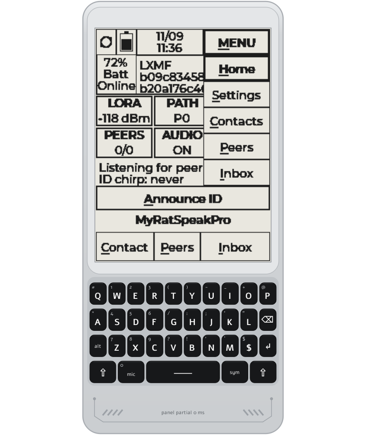

# RatSpeak T-Deck Pro simulator

A desktop app that runs the **real T-Deck Pro firmware** on simulated hardware, in a
window drawn like the device: bezel, e-ink screen and the real keyboard layout.
Use it to try firmware changes without flashing, to run scripted checks, and to make
screenshots for how-to guides.



## What is real and what is simulated

| Real firmware code (compiled unchanged) | Simulated hardware |
|---|---|
| `src/boards/tdeck_Pro/StandaloneApp.cpp`, `main.cpp` | e-ink panel (GDEQ031T10): same framebuffer + row-diff refresh, optional real ~650 ms timing |
| keyboard driver `hal/Keyboard.cpp` (caps, SYM, ALT, lone-Shift = Back) | TCA8418 key matrix (register-level, FIFO) |
| LVGL 8.3.11, `LvglPort`, fonts | CST328 touch (mouse) |
| `SecretVault` (PBKDF2 + AES-GCM, via OS crypto) | BQ27220 gauge + BQ25896 charger (side-panel sliders) |
| core storage, MessageStore, AnnounceManager, IdentityManager | GPS (NMEA RMC/GGA from the side panel) |
| ProtocolRuntime + **Rust protocol** (`protocol/`, host build) | SX1262 LoRa radio: "the air" is UDP multicast, so several simulators talk to each other |
| WiFi settings, auto-connect | WiFi access points (listed in the side panel) |
| | NVS, LittleFS and SD card: folders under `build/simdata/<name>/` |

The ESP32 / Arduino APIs are replaced by host shims in `shim/`; the board-specific
hardware lives in `hw/`. No firmware file is edited to run in the simulator.

## Build (Windows)

You need:
* **Qt 6 (MinGW kit) + MinGW 13.1 + CMake + Ninja** in `%USERPROFILE%\Qt`
  (installed with `aqtinstall`: `aqt install-qt windows desktop 6.10.3 win64_mingw`,
  plus `install-tool ... tools_mingw1310`, `tools_cmake`, `tools_ninja`).
* **Rust** (`rustup`, host `x86_64-pc-windows-gnu`). The pinned toolchain installs itself.
* The protocol's sibling repos next to this repo: `..\rsReticulumLite` and `..\rsLXMFLite`
  (github.com/ratspeak), at the commits in `protocol/prebuilt/xtensa-esp32s3/PROVENANCE.txt`.
* One PlatformIO build of `tdeck_pro_standalone`, which fetches `.pio/libdeps` (LVGL, ArduinoJson).

Then:

```bat
sim\build-sim.bat
```

This builds the Rust protocol for the PC, then the simulator, and copies the Qt DLLs
next to `sim\build\ratspeak-sim.exe`. For VS Code, the CMake Tools extension can also
open `sim/` directly (pick the Qt MinGW kit).

## Run

```bat
sim\run-sim.bat            :: device "device1"
sim\run-sim.bat alice      :: a second, separate device
sim\run-sim.bat bob
```

Each name has its own identity, settings, messages and SD card in `build\simdata\<name>\`.
Delete that folder to factory-reset a simulated device. Devices with different names hear
each other over the simulated LoRa air (also across PCs on the same LAN).

### Keys

| PC | Device |
|---|---|
| letters, Enter, Backspace, Space | same keys (keyboard boots in caps lock; ALT+letter flips case) |
| Shift | Shift (tap alone = Back / ^) |
| Esc | Back (a lone Shift tap) |
| Alt | ALT |
| Ctrl | SYM (hold) |
| Tab or F5 | MIC (full refresh; MIC+SYM = 0) |
| digits and `#()-_+@*/:;'"?!`` ` `` | sent as the right SYM+key combination |
| mouse on keys | press; **right-click latches** a key (for example hold SYM) |
| mouse on the screen | touch |

The side panel has battery level, USB / charge-done, GPS fix, real e-ink timing on/off,
the WiFi access points (with their passwords), screenshot buttons and the USB serial
console (type a firmware serial command at the bottom). The Power box's **Now** line shows what the energy mode is doing: mode, percent of time
asleep, number of sleeps, CPU MHz and whether LoRa is on.

## Live-device mode (real T-Deck Pro over USB)

```bat
sim
un-live.bat COM8
```

The same window, but no firmware runs on the PC: it opens the device's USB serial port,
asks the device to mirror its screen, and shows the device's real e-ink contents in the
drawing (like a VNC viewer). Keys and mouse clicks on the drawing, the PC keyboard and the
console box at the bottom all go to the real device, and its serial log appears in the
console. The status line shows the device's live battery reading. Scripts work here too,
so `key`/`type`/`shot`/`expect` can drive the real hardware for tutorials:

```bat
build
atspeak-sim.exe --name tut --live COM8 --script my-tutorial.txt
```

* The device needs firmware with `src/boards/tdeck_Pro/remote/ScreenMirror.cpp`.
* Close PuTTY or the PlatformIO monitor first: only one program can open the port. The
  link reconnects by itself after a replug or a device reset.
* The device mirrors only while a PC sends its 2 s heartbeat and stops 6 s after the
  last one. Keys are sent as raw TCA8418 events, so caps, SYM, ALT and lone-Shift = Back
  behave exactly as on the keyboard.
* The protocol is plain text lines (`@M on|off|sync`, `@K <raw>`, `@T <x> <y>` to the
  device; `@HELLO`, `@FB <y> <rows> <crc16> <base64>`, `@ST ...` back), described in
  `remote/ScreenMirror.h`.
* The power and environment controls in the side panel are greyed out: the hardware is real.

**Without hardware:** a simulator can stand in for the device. Start one with its USB
serial on a local TCP port, then attach a second one in live mode:

```bat
build
atspeak-sim.exe --name livedev --serial-tcp 5577
build
atspeak-sim.exe --name live --live tcp:127.0.0.1:5577 --script scripts\live_tcp.txt --quit
```

`scripts/live_tcp.txt` checks that the screen mirror, keys and console all go through.

## Scripts (automated checks and tutorial screenshots)

```bat
sim\run-script.bat sim\scripts\wifi.txt
```

runs headless, prints the firmware log, and exits **0 on PASS, 1 on FAIL**. Add a device name and `fresh` (`run-script.bat sim\scripts\power.txt power fresh`) to wipe that device's saved data first; `power.txt` needs it, since Custom keeps the previous run's settings. Screenshots go
to `build\simdata\<name>\shots\`. One command per line, `#` for comments:

| Command | Meaning |
|---|---|
| `wait <ms>` | pause |
| `key <k>` | tap a key: `Q`, `ENTER`, `BKSP`, `SPACE`, `SHIFT`/`BACK`, `ALT`, `SYM`, `MIC`, `$`, `2`, `@`, `SYM+W`, `ALT+Q` |
| `down <k>` / `up <k>` | hold / release a key |
| `type <text>` | type text (upper case as-is, lower case via ALT, digits/symbols via SYM) |
| `touch <x> <y>` | tap the screen at panel coordinates (240 x 320) |
| `shot <file.png>` | save the screen (2x, crisp) |
| `devshot <file.png>` | save the whole device drawing |
| `winshot <file.png>` | save the whole window (device + side panel, incl. the power line) |
| `battery <0-100>` / `usb on\|off` / `full on\|off` / `gps on\|off` | change the hardware |
| `sd in\|out` | insert / remove the SD card (seen at the firmware's next mount); `--nosd` (or `set SIM_ARGS=--nosd` for run-script) starts with the slot empty |
| `serial <text>` | send a line to the firmware's USB serial |
| `expect <ms> <text>` | wait until the serial log shows `<text>`, else FAIL |
| `quit` | stop with PASS |

Included: `scripts/smoke.txt` (boot and menus), `scripts/wifi.txt` (scan, join with
password, saved + encrypted), `scripts/announce_a.txt` + `announce_b.txt` (two devices
discover each other; run both at once), `scripts/live_tcp.txt` (live-device mode, see above),
`scripts/power.txt` (Settings > Power: Saver, sleep statistics, USB forces Full, Custom knobs).
UI features: `lock.txt` then `lock_boot.txt` (password lock, same device name), `share_a.txt`
+ `share_b.txt` (share a contact, run together), `lists.txt` / `inbox_pages.txt` (pages and
find), `identity.txt` then `identity_after.txt` (identity slots, TCP hub settings), `id.txt`
(print the destination hash), `more_box.txt` (the "^ more" cell), `map_menu.txt` (MENU → Map
with no GPS: card start view, zoom fallback; needs tiles in `build\simdata\<name>\sd`). Scripts wait for `[BOOT] ready` rather than a fixed time.

The energy modes run their real logic here; light sleep is a 20 ms pause, and the
console command `pw` shows the mode, knobs and percent of time asleep.

## Limits

* Timing is host timing: CPU and heap numbers are plausible constants, not measurements.
* The radio delivers every packet (no range, collisions or loss) and holds TX for the real airtime.
* Audio is a log line plus a flashing speaker dot; vibration shakes the drawing.
* `shim/src/mbedtls_host.cpp` uses Windows CNG. Building on macOS or Linux needs a small
  OpenSSL version of that file; the rest is portable C++17 and Qt.
