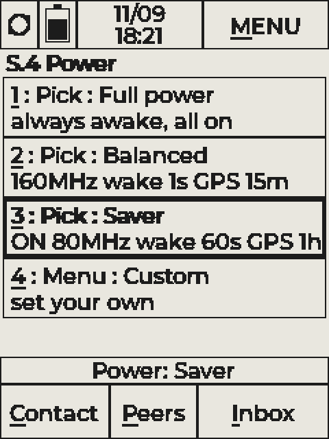
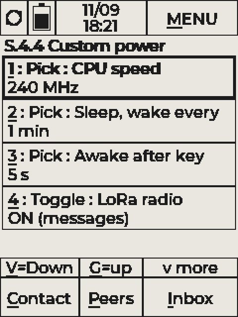

# RatSpeak T-Deck Pro — Guide

**Audience:** operators holding the device, and developers working on the firmware,
the desktop simulator or the hardware bring-up.  
**Input priority:** **keyboard first**; touch is secondary.  
**Radio priority:** **LoRa mesh / LXMF first**. WiFi (station) is optional.  
**Stable hotkeys:** **I**, **C**, **M**, **P** (do not reassign lightly).

Related code: `StandaloneApp.cpp` (the whole app), `hal/Keyboard.cpp`, `power/`
(energy modes, light sleep), `remote/ScreenMirror.*` (USB screen mirror),
`security/SecretVault.*`, `sim/` (desktop simulator), `tools/gpscheck/` (GPS bench check).

**Figures:** `images/screen-*.png`, the RatSpeak UI on the LilyGo T-Deck Pro bezel and
keyboard. Selection = bold outline; MENU underline under **M** only; bottom underlines
under **C / P / I**.

Status words used below: **Works** (in the firmware and checked on hardware),
**Built** (in the firmware, checked in the simulator or partly on hardware),
**Planned** (designed, not written yet).

---

## 1. How to

### 1.1 Send a message

1. Wake if idle → any key.  
2. **I** → Inbox *(skip if already on Inbox or in the right thread)*.  
3. Select the contact by **touch** or **number**, then **Enter**.  
4. Type the message (**Alt** for case). Nav underlines go off while typing.  
5. **Enter** to send.  
6. Optional **^** back to the list.

```text
I  →  select  →  type  →  Enter  →  ^ (optional)
```

### 1.2 Add / name a contact

**Discover first (two radios):** on each device, Home → **Announce ID**, then open
**Peers** (**P**) and confirm the other appears.

1. **C** → Contacts *(or **P** Peers if they are not saved yet)*.  
2. Select the device (touch, **V**/**G**, or digit).  
3. **Enter** to open name edit, type the name (**Alt** for case), **Enter** to save.

Row **0** is always **this** device (**MyID**). Rename it the same way to set the
local display name. The default is **TDP-** plus the last four hex digits of the MAC
(e.g. `TDP-179C`), so units on one table can be told apart; console `name <text>` sets it
too (`name` alone restores the default).

### 1.3 First-boot setup

| Step | What | How |
|------|------|-----|
| 1 | **Time** | **M → S → 1** (Time & Location) → Set RTC (**S.1.1**), Time zone (**S.1.2**) |
| 2 | **Theme** | **M → S → 3** (Screen & I/O) → **1** Theme: **White paper** / **Black ink** |
| 3 | **Power mode** | **M → S → 4** (Power) → Full / Balanced / Saver / Custom (§6) |
| 4 | **Name this device** | **C** → row **0 MyID** → type name → **Enter** |
| 5 | **WiFi** (optional) | **M → S → 2** — scan, join, saved networks, auto-connect |
| 6 | **Meet the other radio** | Announce ID on both → **P** → name contact (§1.2) → test send (§1.1) |

A **second LoRa RatSpeak device** in range is needed to check messaging.

### 1.4 Install on a T-Deck Pro

1. Plug in USB. Build env **`tdeck_pro_standalone`** in PlatformIO.  
2. Upload. On these boards the esptool "stub" often fails ("Unable to verify flash
   chip connection"); the ROM loader works and needs **no buttons**:

   ```bash
   ~/.platformio/penv/Scripts/python.exe ~/.platformio/packages/tool-esptoolpy/esptool.py --chip esp32s3 --port COM8 --baud 115200 --before default_reset --after hard_reset --no-stub write_flash --flash_mode dio --flash_freq 80m --flash_size 16MB 0x10000 .pio/build/tdeck_pro_standalone/firmware.bin
   ```

   If a board will not enter the loader by itself: hold the **top** button, press and
   release the **bottom** button, then release the top one.  
3. Serial console: **115200** baud (§11).  
4. Continue with §1.3.

**Bench build without LoRa** (antenna disconnected — never transmit without one):
`RS_NO_RADIO=1` keeps the SX1262 unpowered (`LORA_EN` low), so it can never transmit.

```bash
PLATFORMIO_BUILD_FLAGS="-DRS_NO_RADIO=1" PLATFORMIO_BUILD_DIR=".pio/build_noradio" pio run -e tdeck_pro_standalone
```

### 1.5 See the device's screen on a PC (USB remote)

`sim\run-live.bat COM8` opens the desktop simulator window in **live mode**: it shows
the real device's e-ink contents and sends the PC keyboard / mouse to the device (§10.3).

### 1.6 Make the battery last longer

**M → S → 4** (Power) and pick **Balanced** (a day-to-day choice) or **Saver** (longest
runtime). Keys and incoming messages stay immediate in every mode; see §6 for what
changes. While USB power is plugged in the device runs **Full** anyway (row 5).

---

## 2. Physical controls

| Key | Browse mode | Entry mode |
|-----|-------------|------------|
| **I** | Inbox | types letter |
| **C** | Contacts | types letter |
| **P** | Peers | types letter |
| **M** | MENU overlay (**H**ome · **S**ettings · **C**ontacts · **P**eers · **I**nbox) | does **not** open the menu |
| **H** | Home | — |
| **G** / **V** | Up / down | — |
| **1**–**9**, **0** | Lists: select row. Settings: select **and** activate row 1–9, **0** = row 10 | digits (numeric fields) |
| **Enter** | Activate / open | Send / save |
| **Alt** | — | Case shift while typing |
| **SYM** | — | Digits / symbols |
| **Shift** (tap alone) **= ^** | Back | Back / cancel |
| **MIC** | Full e-ink refresh (clears ghosting) | — |

There is **no S hotkey**: Settings is **M → S**. Touch is secondary (MENU tab, bottom
tabs, list rows, settings rows). Idle wake is **key only**.

The keyboard boots in caps lock (letters type upper case; **Alt+letter** flips case).
The TCA8418 holds only 10 events, so keys are also read while the panel is refreshing
and queued (48 events) — nothing typed during a refresh is lost.

---

## 3. Navigation model

**Browse:** hotkeys and underlines active; **G/V** move; digits select (Settings rows
activate).  
**Entry:** a text field or the compose line is focused — **M/C/P/I** do not navigate.  
**MENU overlay:** **M** opens a column under MENU; top bar stays visible.  
**Settings:** sub-pages form a stack; **^** returns to the exact row you came from.
Row text is `n : Kind : Name` with the value underneath. Kinds: **Menu** (opens a page),
**Toggle**, **Pick** (Enter steps to the next value), **Entry** (type a value),
**Action**, **Info**.  
**Scroll:** **v more** / **^ more** appear only when more rows exist.

---

## 4. Screen map & figures

### 4.1 Idle splash


Logo, date/time, battery %, plug status, unread line, uptime, device name. Updates at
most once a minute. **Press a key to wake** (touch does not wake).

### 4.2 Home


Status tiles, **Announce ID**, device name. Bottom **Contact | Peers | Inbox**.

### 4.3 Home with MENU overlay


### 4.4 Contacts


**0: MyID** = this radio.

### 4.5 Inbox (list)


Per-row **unrd ##** when unread.

### 4.6 Inbox thread (typing)


### 4.7 Settings root


### 4.8 Settings S.3 Screen & I/O


### 4.9 Settings S.4 Power, S.4.7 Custom and S.4.8 Check-in schedule



Simulator screenshots (`sim/scripts/power.txt`): Saver selected; Custom with CPU set to 240 MHz.

---

## 5. Settings tree (`S.*`)

```
S     Settings                      ← M then S
├── S.1   Time & Location
│   ├── S.1.1  Set RTC              hour, minute, month, day, year → Apply
│   ├── S.1.2  Time zone            18 zones (EST … UTC+9)
│   ├── S.1.3  Enable GPS           shows heard/in-view satellites, "backup cell low", or "resting"
│   ├── S.1.4  Manual location      latitude / longitude / clear
│   ├── S.1.5  Sync GPS now         needs a fix
│   └── S.1.6  Auto GPS sync        boot + daily
├── S.2   WiFi                      status, IP
│   ├── S.2.3  Scan networks        pick → saved: join; new locked: type password
│   │   └── …  Join WiFi            Password · Auto-connect · Join (saves on success)
│   ├── S.2.4  Saved networks       up to 8; passwords sealed (§12)
│   │   └── …  Saved network        Connect now · Auto-connect · Password · Forget
│   └── S.2.5  Disconnect           radio off, auto-connect paused until a manual join
├── S.3   Screen & I/O
│   ├── S.3.1  Theme                White paper / Black ink
│   ├── S.3.2  Idle splash          Off / On (no password) / On + password (planned) / timeout
│   └── S.3.3  Key backlight        (a power mode may hold it off)
├── S.4   Power                     energy modes (§6)
│   ├── S.4.1  Full power
│   ├── S.4.2  Balanced             (default)
│   ├── S.4.3  Saver
│   ├── S.4.4  Ultra-low            LoRa listening only
│   ├── S.4.5  On demand            LoRa 2 min after a key
│   ├── S.4.6  Check-in             LoRa only in scheduled windows (§6.7)
│   ├── S.4.7  Custom               → S.4.7.1–9 knobs (§6.2)
│   ├── S.4.8  Check-in schedule    minute · every · next · waiting · clock (§6.7)
│   ├── S.4.9  Energy monitor       per-part mAh vs gauge, trend graph (§6.5)
│   ├── S.4.10 Full power on USB    ON (default) / OFF
│   ├── S.4.11 Now                  CPU MHz and % of time asleep
│   └── S.4.12 Battery draw         mA and estimated time left (gauge)
├── S.5   Battery                   volts, %, current, charger status, capacity
│   ├── S.5.8  Battery log          internal RAM ring / SD CSV, dump to USB
│   └── S.5.10 Reset calibration
├── S.6   Identity                  destination, display name, LXMF address, Announce
├── S.7   LoRa                      915 MHz; link preset (Long Fast / Long Slow / Medium / Fast Short)
├── S.8   Alerts                    beep, vibrate, volume, test
├── S.9   Diagnostics               paths/links, LXMF queue, peers, uptime
└── S.10  Storage  (key 0)          heap, PSRAM, flash, messages, SD card (+ S.10.5 SD), secrets key
```

---

## 6. Power & energy modes (S.4) — Works (light sleep verified 2026-11-10)

The ESP32-S3 awake is the biggest single load (~50 mA of a ~80–100 mA total); a powered
GPS adds ~20–30 mA, the LoRa receiver ~10 mA, the audio path ~15–20 mA while it runs.
The energy modes trade background responsiveness for runtime. **Keys and incoming LoRa
messages are immediate in every mode**, because they wake the processor directly.

### 6.1 The modes

| | **Full power** | **Balanced** (default) | **Saver** | **Ultra-low** | **On demand** | **Check-in** |
|---|---|---|---|---|---|---|
| CPU clock (awake) | 240 MHz | 240 MHz | 240 MHz | 240 MHz | 240 MHz | 240 MHz |
| Light sleep, wake every | never | **1 s** | **60 s** (on the minute) | **5 min** | **5 min** | **5 min** |
| Stay awake after a key | — | 15 s | 5 s | 5 s | 10 s | 10 s |
| LoRa receiver | on | on | on | on | **2 min after a key** | **in the windows** (§6.7) |
| GPS | always on | every 15 min | every hour | off | one fix on a key (≤ every 15 min) | same |
| WiFi / key backlight | allowed | allowed | off | off | off | off |
| Touch | on | on | 1 min after a key | 1 min after a key | 1 min after a key | 1 min after a key |
| Battery draw | ~48 mA, ~67 with GPS | ~9–10 mA | ~7 mA | ~7 mA (est.) | ~6 mA (est.) | ~6 mA (est.) |
| Runtime (~1450 mAh) | ~21–30 h | ~5–6 days | ~6–8 days | ~8 days | ~10 days | ~10 days |
| Messages in | immediate | immediate | immediate | immediate | only while LoRa is on | only in a window |

Plus **Custom** (your own knobs, §6.2). Runtimes on S.4 come from these bench numbers.
Ultra-low, On demand and Check-in all sit on the **~4 mA board floor** (§6.6): parts
that stay powered whatever the ESP32 does. A month (~2 mA) needs that floor lowered first.

**Full power on USB** (S.4.10, default ON): whenever USB power is present the device
runs **Full**, whatever mode is chosen, and goes back to the chosen mode when unplugged.
The Power row on the Settings root then reads e.g. `Saver (USB: Full)`.

Modes are stored in NVS namespace `rs_power` and survive reboots.

### 6.2 Custom knobs (S.4.7)

Choosing **Custom** the first time copies the mode you were in, then each row changes
one knob (Enter steps to the next value):

| Row | Knob | Values |
|---|---|---|
| 1 | CPU speed | 240 · 160 · 80 MHz |
| 2 | Sleep, wake every | never · 1 s · 5 s · 10 s · 30 s · 1 min · 5 min |
| 3 | Awake after key | 3 · 5 · 10 · 15 · 30 · 60 s |
| 4 | LoRa radio | ON (messages) · 2 min after a key · OFF (no messages in or out — the radio chip sleeps) |
| 5 | GPS | Always on · Every 15 min · Every hour · Off · When used |
| 6 | WiFi | allowed / OFF |
| 7 | Key backlight | allowed / OFF |
| 8 | Touch | always on / 1 min after a key |
| 9 | Reset to Balanced | |

Example: GPS off but snappy UI → Custom, CPU 240, sleep "never", GPS Off.

### 6.3 How it works underneath

- **CPU clock:** `setCpuFrequencyMhz()`. 80 MHz is the lowest clock that keeps the PLL,
  USB console and peripherals running normally.
- **Light sleep** (`power/LightSleep.cpp`): the CPU clocks stop but RAM, PSRAM and every
  pin level are kept, so the e-ink image stays, the LoRa radio keeps listening and
  nothing re-initialises. Wake-up takes about a millisecond. Wake sources:
  - **timer** — the mode's wake interval (Saver lands on the minute so the clock stays right);
  - **key** — TCA8418 INT (GPIO 15, low); the chip's interrupt is acknowledged before each sleep;
  - **touch** — CST328 INT (GPIO 12, low), not while the idle splash shows;
  - **LoRa packet** — SX1262 DIO1 (GPIO 5, high = RX done); the radio's edge interrupt is
    re-armed after the wake and the packet is read at once.
- **Why light sleep needed a build change:** the vendored ESP-IDF *deep*-sleep backports
  (`vendor/esp_idf_compat/rtc_sleep.c`, `rtc_init.c`, pulled in by `core/compat/`)
  replace the SDK's own functions and break *light* sleep on IDF 4.4.7: every
  `esp_light_sleep_start()` ended in a watchdog reset (reason 7) within a second, which
  made Balanced/Saver boot-loop on battery. Found by bisection (a bare sketch sleeps on
  the same boards; with RatSpeak's sources it resets; without those two files it works).
  The `tdeck_pro_standalone` env leaves them out; the T-Deck Pro uses no deep sleep.
- **When the CPU stays awake anyway** (the "blocker", console `pw`): within the stay-awake
  time after a key; the first 15 s after boot; a redraw or queued key pending (not while
  the idle splash shows — the splash is redrawn when a key wakes it); a LoRa packet being
  read or sent; **frames queued in the LoRa interface** and **3 s after any LoRa wake**
  (so delivery proofs and path responses go out before sleeping again); LXMF messages
  waiting to be sent; **WiFi on**; **GPS powered** (its serial data would be lost);
  screen mirror active; **a USB host attached** (unless `usbsleep` — the USB console
  disconnects while asleep and reconnects on wake).
- **Messages while asleep:** a LoRa packet wakes the CPU at once; it then stays awake while
  the LoRa interface has frames queued, for 3 s after the wake, while **received messages
  are still being written to flash** (the delivery proof is sent only after the write, and
  the write-queue task is frozen in light sleep), and it wakes for the protocol's next
  scheduled reply (path response). With these, a sleeping receiver delivered 14/14
  messages at 1.3 sender frames per message, as well as an always-awake one.
- **GPS rail off → UART TX held low:** with the GPS unpowered, an idle-high UART TX line
  back-powered the receiver through its RX pin (+18 mA, the old "27 mA floor"). The UART
  is released and TX driven low whenever the GPS rail is off.
- **Touch** is held in reset while the idle splash shows (every mode: key-only wake, no
  accidental touches) and, with "Touch: 1 min after a key" (Saver), except for 60 s after
  the last key or touch. Saves ~2 mA.
- **Before each sleep** the e-ink power stage is switched off (GxEPD2 leaves it on after a
  refresh; the next refresh powers it again, ~50 ms).
- **Audio is power-gated in every mode:** the DAC/amplifier rail (GPIO 41) and the I2S
  clocks + DMA (which run continuously even when silent) are on only while a sound plays
  and switch off after 3 s of silence. Switching on costs ~20 ms before a beep.
- **LoRa off:** the interface stops (queued frames are dropped) and the SX1262 goes to
  warm sleep (~1 µA). Its power rail (GPIO 46) stays on: cutting it while the ESP32
  drives the SPI lines back-powers the chip and *raises* the draw (measured +20 mA).
- **GPS schedule:** a "visit" powers the receiver (GPS_EN, GPIO 39) until a fix has held
  for 20 s (which also syncs the clock if Auto GPS sync is on) or 3 minutes pass, then
  powers it off until the next interval. The backup cell keeps satellite data, so later
  visits are usually hot starts. S.1.3 shows `resting (Every hour)` between visits.
- **WiFi off:** the radio is turned off and scans / auto-connect are refused with a toast.
- **Key backlight:** lit only if S.3.3 is ON **and** the mode allows it.
- **Battery estimate:** S.4.7 shows the gauge's average current and its TimeToEmpty.

### 6.4 Measuring

- Console `pw`: mode, knobs, % asleep, wake counts by cause, the current blocker, battery,
  unread messages and LXMF queue.
- Console `bench <s>` (max 4 h): turns the charger's input off (BQ25896 EN_HIZ) and its
  I²C watchdog off (otherwise the charger re-enables its input after 40 s, e.g. while the
  CPU sleeps), so the board runs from its battery with USB still connected. Ends by time,
  below 3.55 V, or `bench 0`; every boot switches the charger input and watchdog back on.
  Refused below 3.70 V or with no battery.
- Console `usbsleep <s>`: allow light sleep with a USB host attached (the console drops
  during each sleep). `rl` dumps the RTC power log, which survives resets and records
  voltage, current, uptime and sleep counts every wake, plus a BOOT line per reset.
- `pset <knob> <value>` sets one Custom knob; `epdoff 0|1`, `audio 0|1`, `gpio <pin> <0|1>`
  and `txp <dBm>` are bench switches.

Measured 2026-11-10 (gauge average current, battery 4.1–4.2 V, USB attached with the
charger input off — identical to an unplugged run on COM9):

| Configuration | Asleep | Battery draw |
|---|---|---|
| 240 MHz, never sleeps, LoRa on, GPS off (Full) | 0% | ~48 mA |
| same with GPS on | 0% | ~67 mA |
| 240 MHz awake, before the audio / front-light / GPS fixes (COM8, 11-09) | 0% | ~99 mA |
| 80 MHz, never sleeps, LoRa off | 0% | ~79 mA |
| Saver preset, between GPS visits | 98% | **~7 mA** |
| wake every 1 s, LoRa listening (Balanced-like) | 87% | ~9 mA |
| wake every 60 s, LoRa off, touch on | 98% | ~8 mA |
| before the GPS UART fix, same config | 98% | ~26 mA |
| board alone, ESP32 in deep sleep, every rail off (tools/sleepcheck floor) | — | ~5 mA |
| board alone, ESP32 in light sleep | — | ~7 mA |

So asleep: ~5 mA is board hardware the firmware does not switch (sensor hub, keyboard and
e-ink controllers, mic, SD card, regulators), ~1.5–2 mA the ESP32 + PSRAM in light sleep,
~2 mA the touch controller unless gated, ~1–2 mA the LoRa receiver. A GPS visit costs
~68 mA while it lasts (ends after a 20 s fix, after 3 min, or after 60 s with no satellite
heard).

Mistakes this measuring caught: cutting the LoRa rail with SPI lines driven back-powers the
SX1262 (+20 mA); an idle-high GPS UART line back-powers the GPS (+18 mA); GPIO 45 (front
light on v1.1) was driven high as "touch reset" (+2 mA).

**LoRa stress tests** (receiver in a sleeping mode on battery, senders at −9 dBm on one table):

| Receiver firmware / setup | Messages | Delivered | Sender frames / message |
|---|---|---|---|
| sleeping, before the reply fixes (2 h, 2 senders) | 161 | 45% | ~9.3 |
| never sleeping, 240 MHz (control) | 42 | 100% | ~1.1 |
| sleeping, all fixes, fresh store (1 sender, 20 min) | 14 | **100%** | **~1.3** |

A message store bloated by thousands of test messages slows every write (and boot, to ~2
minutes); that also delays proofs. Separate storage issue, tracked in Future_steps.txt.

### 6.5 Energy monitor (S.4.9)

**Settings → Power → Energy monitor** shows where the battery charge goes. The board has one
current sensor (the gauge, total only), so the split is an **estimate**: the time each part
spends in each state × its bench-measured current (CPU awake by clock or asleep, LoRa
listening, LoRa transmit airtime × PA current at the set power, GPS powered, WiFi on, key
light, touch scanning, audio path, e-ink refresh time, SD mounted, board base). The gauge's
average current over the same time is the **measured** total; *Other* = measured − estimated
shows how good the estimate is. On USB power there is no battery measurement.

- Rows: trend graph · view (last closed period / this period so far) · measured · estimated
  total · each part largest first (mAh and %) · Other · % awake and battery %.
- **Trend graph:** average current per period, newest right (filled bar = measured,
  outlined = estimate only), the period in progress at the right edge, and the largest
  consumers over the shown periods.
- Periods are 1 hour; records go into a 48-entry ring in RTC memory (kept through resets,
  lost on a power loss). Console: `energy` (dump), `energy period <s>` (e.g. 300 for
  testing), `energy clear`.

**E-ink refreshes:** a partial (non-blinking) refresh takes ~0.7–0.8 s and a full (blinking)
one ~1.1–1.8 s at a few mA — with the clock updating once a minute that is well under
0.1 mA on average. The panel datasheet (GDEQ031T10) recommends a full refresh after about 5
partial ones to stop afterimages building up; partial refreshes do not wear the panel.
RatSpeak does a full refresh whenever the idle splash appears and on wake, and MIC forces
one at any time.

### 6.6 Board floor (2026-11-10)

`tools/sleepcheck` (`floor d 14`: ESP32 in deep sleep, all switchable rails and pins low,
charger input off) measures **~4 mA** (gauge 3–5 mA; its average filter lags for minutes).
That is what is left with the ESP32 effectively off: the always-on 3.3 V buck and 1.8 V
LDO, gauge, charger, keyboard controller, SD card, e-ink controller, sensor hub.

Four units, `floor d 8 300` (8 × 5 min deep sleep), 2026-11-10:

| Unit | SD card | BHI260 boot status | Gauge avg current | Battery voltage over 35 min |
|---|---|---|---|---|
| COM6 | no | 0x18 (idle, no firmware) | 3–4 mA | −2 mV |
| COM3 | no | 0x38 (firmware loaded) | 3–4 mA | −3 mV |
| COM5 | no | 0x38 (firmware loaded) | 4–6 mA | −4 mV |
| COM9 | yes | 0x18 | **0 mA** | −4 mV |

- **The gauge cannot resolve this.** COM9 reads 0 mA while its voltage falls like the
  others: below a few mA the BQ27220 reading is dominated by its deadband and per-unit
  offset. The real floor is somewhere around 1–5 mA; only a meter in series with the
  battery will say.
- Neither a loaded BHI260 (COM3/COM5) nor the SD card (COM9) stands out.
- With 30 s cycles (a full reboot each) the reading also showed a burst every ~7.5 min
  (7–8 mA, −13 mV dip, slow decay); with 5 min cycles it mostly disappears.
- **Next: measure it properly.** Planned rig (~$15): an INA226 current-sensor board
  (0.1 Ω shunt, ~25 µA steps) in the battery's + lead via a cut JST-PH 2.0 mm extension
  (IN+ battery side, IN− board side), read over I2C by a small ESP32 that logs to the PC
  over USB; continuous logging shows wake bursts and the true average. A USB inline
  tester does not work for this (it measures the charger input). Then the e-ink
  controller's deep-sleep command and the keyboard controller.
- **Rig software (2026-11-11):** `tools/inalogger` has the logger firmware (ESP32-C3
  SuperMini, SDA 8 / SCL 9, INA226 auto-detected at 0x40–0x4F, ~1.2 ms conversions) and
  `log.py` (CSV, window/overall average, charge, wake bursts, battery-life estimate,
  `--zero` offset, `--summary` of a saved CSV). Wiring and use: `tools/inalogger/README.md`.
  Built and self-tested; not yet run on hardware.

### 6.7 Check-in mode (S.4.6, S.4.8)

All devices set to the same schedule (e.g. every hour at :30) keep LoRa **off** except
in a short window around each check-in:

```
 :29:00  LoRa on (1 min early: clocks may differ)
 :30:05  announce (peers learn the path; a GPS-synchronized clock gives its time)
 :30:20  send the messages written since the last window (one every ~3.5 s)
 :31:30  announce again (reaches a peer whose clock is up to ~1.5 min late)
 :33:00  LoRa off until :29 next hour
```

- **Writing a message outside a window** queues it ("Queued for 14:30 check-in", up to 8,
  kept in RAM through light sleep); the console `msg` command queues the same way.
- **Clock sync, no protocol change.** Reticulum announces carry the sender's time (the
  low 5 bytes of the announce `random_hash`) when its clock is GPS/NTP synchronized, and
  LXMF messages carry their creation time. A device whose own clock is not synchronized
  this boot adopts an announce time outright, and moves forward to a message time (never
  backward, at most 15 min, so a late retry can't pull it back): unsynced devices
  converge on the fastest clock, synchronized ones give true time. A GPS fix now also
  marks the clock synchronized for the protocol (it did not before), so announces carry
  real time.
- **S.4.8** sets the minute (Enter = +5) and the period (15 min … 24 h) and shows the next
  check-in, messages waiting, and where the clock came from.
- Clocks must start within ~1 minute (set the clock, or one GPS fix); each window then
  resyncs them. A clock far off (an hour) misses the windows entirely.
- Console: `checkin` (status), `checkin <minute> [every-min]` (bench: any period ≥ 5 min),
  `epoch [secs]` (show / set the clock).

### 6.8 Next

- **Board floor** (§6.6): INA226 logger in series with the battery (the gauge cannot
  resolve it), then e-ink controller and keyboard.
- **Check-in:** keep the outbox in NVS (RAM only today), show queued messages in the
  thread, measure RTC drift over a day to size the 1 min lead.
- **Repeater / propagation-node sync** for Check-in and On demand.
- **Message store performance** with many messages (slow writes and boot).
- **LoRa receive duty cycle** (SX1262 RX duty-cycle with preamble detection) — the
  receiver costs ~10–20 mA of the sleeping draw; RNode-style 18-symbol preambles allow it.
- **Deep sleep "storage" mode:** would need the deep-sleep backports, which break light
  sleep — only one of the two can be linked as things stand.
- **GPS power-save mode** on the u-blox M10 (cyclic tracking) instead of full off/on.

---

## 7. Idle & notifications

| Topic | Behaviour |
|-------|-----------|
| Timeout | **S.3.2** (10–99999 s, default 30 s); never while a draft is unsent |
| Wake | Any **key** |
| Unread on splash | Updates on receive without leaving idle |
| Beep / vibe | **S.8** when enabled |
| With energy modes | The splash and light sleep are independent; in Balanced/Saver the device usually sleeps behind the splash |

---

## 8. GPS — Works (receiver-dependent)

The T-Deck Pro has a u-blox **MIA-M10Q** (UART1, 38400 baud, RX 44 / TX 43, power
GPS_EN 39) with a ceramic patch antenna, and a small rechargeable **MS621FE** backup cell
(J6, charged from 3.3 V through D8 + R15) on its V_BCKP pin.

- The firmware listens to NMEA (GGA, RMC, GSV), counts satellites heard per
  constellation, and logs the receiver's `$GxTXT` notices.
- **Link recovery:** if no valid sentence arrives for 3 s it cycles baud rates and sends
  u-blox "clear saved config + load defaults" (like LilyGo's `GPS_Recovery()`), then
  re-enables NMEA in RAM.
- **Backup-supply fault:** a receiver that reports `CANNOT USE BBR -> NO GNSS OPERATION`
  refuses to navigate. The firmware shows "backup cell low" and power-cycles the
  receiver every minute (every 5 min after 10 tries). On the unit at COM8 this fault is
  permanent under RatSpeak, LilyGo's own test and factory firmware; the unit at COM9
  navigates normally, as do three more units checked on 2026-11-09 (MACs …0E:34,
  …14:48, …17:CC). Suspected cause: the J6 cell or its D8 / R15 charge path on COM8.
- **Bench check of any unit:** `tools/gpscheck/check.sh COMx` flashes a tiny check app
  (LoRa kept off), listens 70 s and prints `VERDICT: GPS OK / GPS FAULT / NO DATA`.
- Console: `g` (status dump), `gp` (power-cycle the receiver), `gr` (hardware reset).

---

## 9. Hardware notes (T-DeckPro V1.1, 25-09-15)

| Function | Part | Pins / bus |
|---|---|---|
| MCU | ESP32-S3, 16 MB flash, 8 MB QSPI PSRAM | USB-Serial-JTAG console |
| Display | 3.1" e-ink GDEQ031T10, 240 × 320 | SPI CS 34, DC 35, BUSY 37, RST 16 |
| Keyboard | TCA8418, 4 × 10 matrix | I²C 0x34, INT 15, backlight 42 |
| Touch | CST328 | I²C 0x1A, INT 12, RST 45 |
| LoRa | SX1262, TCXO, DIO2 RF switch | SPI CS 3, IRQ 5, RST 4, BUSY 6, enable 46 |
| GPS | MIA-M10Q | UART 44/43, enable 39 |
| Gauge / charger | BQ27220 / BQ25896 | I²C 0x55 / 0x6B |
| Haptics | DRV2605 | I²C 0x5A |
| Audio | I²S amp | BCK 7, DOUT 8, WS 9 |
| SD card | | SPI CS 48 |

The battery gauge often stops at ~85% when full (the charger terminates before the
gauge sees the taper), so each device learns its own full point at a charge-done and
scales by it (S.5.9 "Full-charge cal").

---

## 10. Desktop simulator (`sim/`) — Works

A Qt app that runs **the real firmware** (`StandaloneApp.cpp`, keyboard driver, LVGL,
storage, the Rust protocol) on simulated hardware, in a window drawn like the device:
light frosted case, black keys with their symbol legends, the e-ink screen.
Full instructions: `sim/README.md`.

### 10.1 What it is for

- Try firmware changes without flashing.
- Run several simulated devices that talk to each other over a simulated LoRa "air"
  (UDP multicast — also across PCs on the same LAN).
- Scripted checks (exit code 0 = PASS) and screenshots for guides like this one.

### 10.2 Running

```bat
sim\build-sim.bat
sim\run-sim.bat alice
sim\run-script.bat sim\scripts\smoke.txt
```

Each name keeps its own identity, settings, messages and SD card under
`sim\build\simdata\<name>\`. The side panel sets battery %, USB / charge-done, GPS fix,
real e-ink timing, WiFi access points, and has a USB serial console box.

In the simulator the energy modes run their full logic (profiles, GPS schedule, sleep
decisions, statistics); "light sleep" is a 20 ms pause, since there is no hardware to
power down.

### 10.3 Live-device mode

```bat
sim\run-live.bat COM8
```

No firmware runs on the PC: the window shows the **real device's screen** over USB
(like VNC) and sends keys, clicks and console lines to it. The device mirrors only while
the PC's 2 s heartbeat arrives and stops 6 s after the last one. Scripts work here too,
so tutorials can be driven on real hardware. Protocol (`remote/ScreenMirror.h`): `@M`,
`@K`, `@T` in; `@HELLO`, `@FB <y> <rows> <crc16> <base64>`, `@ST` out. While mirroring
the device does not light-sleep.

---

## 11. USB serial console (115200 baud)

| Command | Does |
|---|---|
| `t:<text>` | send `<text>` in the open thread |
| `a` | announce |
| `h` `i` `c` `p` `s` | go to Home / Inbox / Contacts / Peers / Settings |
| `d` | dump the battery log |
| `g` / `gp` / `gr` | GPS status / power-cycle / hardware reset |
| `pw` | power status: mode, knobs, % asleep, wakes, blocker, battery |
| `pm0` … `pm3` | set mode: Full, Balanced, Saver, Custom |
| `bench <s>` | run from battery with USB attached (charger input + its watchdog off) for up to 4 h; `bench 0` stops |
| `usbsleep <s>` | allow light sleep with a USB host for `<s>` s (the console drops while asleep); `usbsleep 0` blocks it |
| `pset <knob> <v>` | set a Custom knob and switch to Custom: `cpu 80\|160\|240`, `wake <s>`, `awake <s>`, `lora 0\|1`, `gps 0-3`, `wifi 0\|1`, `kbl 0\|1` |
| `blog 0\|1` | internal battery log off / on (RAM ring, 120 samples) |
| `rl` / `rl 0` | dump / clear the RTC power log (survives resets: time, uptime, mV, mA, USB, sleeps; a BOOT line with the reset reason at every boot) |
| `sleeptest <ms> [guard] [stop]` | diagnostic: one timer-only light sleep; stop bits 1 audio, 2 GPS, 4 LoRa |
| `msg <32 hex> <text>` / `id` | send a message to a destination hash / print this device's destination |
| `txp <dBm>` | LoRa transmit power, −9…22, saved (bench builds with `RS_BENCH_TX_DBM` default to it) |
| `epdoff 0\|1` / `audio 0\|1` / `gpio <pin> <0\|1>` | bench switches: e-ink off before sleep, audio path, raw output pin |
| `energy` / `energy period <s>` / `energy clear` | energy monitor: per-period measured and estimated mAh by part (§6.5) |
| `checkin [min [every]]` / `epoch [secs]` | check-in schedule and status; show / set the clock (§6.7) |
| `pm0`…`pm6` | Full, Balanced, Saver, Ultra-low, On demand, Check-in, Custom |
| `L` | toggle key backlight |
| `FORMAT` | erase and format the data partition |
| `@…` | screen-mirror protocol (§10.3) |

Log prefixes: `[BOOT] [CFG] [POWER] [BENCH] [GPS] [LORA] [WIFI] [EINK] [BAT] [UI] [PROTO] [MSG] [RTCLOG]`.

---

## 12. Secrets at rest (SecretVault)

Saved secrets (today: WiFi passwords) are never written to flash as plaintext.
`security/SecretVault` derives a key with PBKDF2-HMAC-SHA256 (10 000 rounds) from
**password + chip MAC + a random per-device salt** (NVS `rs_vault`), then seals each
secret with AES-256-GCM (random nonce, SSID as associated data).

- **Now:** the password is a built-in default, applied automatically at boot. This stops
  a flash dump or copied NVS from being read on a PC, but not someone holding the device.
- **Planned:** the idle-screen password (S.3.2 "On + password") becomes the vault
  password; at boot the vault stays locked until it is typed, so WiFi auto-connect waits.
- **Strongest option (not enabled):** ESP32-S3 flash + NVS encryption. Burns eFuses and
  can't be undone, so it is a deliberate per-device decision.

---

## 13. Stable hotkey policy & implementer checklist

**I / C / M / P** must stay. Settings is reached via **M → S** only. **Alt** = case in
entry mode.

1. Browse vs entry gates **I/C/M/P**.  
2. Underlines only when the action works.  
3. Settings rows are built by one function per page; count, numbering, digit jumps and
   touch hits all come from it.  
4. Input handlers request a redraw; only `loop()` renders.  
5. Idle: key wake only.  
6. Announce never implies private-key export.  
7. Hardware changes for power go through `powerApply()` only.

---

## 14. Roadmap (near term)

| Item | Status |
|---|---|
| Energy modes Full / Balanced (default) / Saver / Ultra-low / On demand / Check-in / Custom (§6.1) | Works |
| Light sleep | Works: deep-sleep backports excluded from the T-Deck Pro build (§6.3) |
| Sleeping draw 27 → ~7 mA (GPS UART back-power fix, touch gating) | Done |
| LoRa delivery to a sleeping receiver | Done: 14/14 at 1.3 frames/message |
| Energy monitor: per-part estimate vs gauge, hourly trend graph (§6.5) | Works |
| Check-in mode: scheduled LoRa windows, outbox, peer clock sync (§6.7) | Works on 2 units; outbox in NVS, queued messages in thread, RTC drift next |
| Board floor ~1–5 mA with the ESP32 off (§6.6) | Gauge cannot resolve it; INA226 logger software ready (`tools/inalogger`), needs the parts wired; then e-ink controller / keyboard sleep |
| GPS check of all five units (`tools/gpscheck`): only COM8 has the backup fault; COM3, COM5, COM6, COM9 OK | Done — report to LilyGo next |
| Message store performance (slow writes, 2–4 min boot with thousands of messages) | Planned |
| Idle password + vault unlock | Planned |
| Deep-sleep storage mode, LoRa RX duty cycle, GPS power-save | Planned |
| Repeater / propagation-node sync for Check-in and On demand | Planned |
| Simulator: show power state / sleep % in the side panel | Planned |

---

## 15. Document history

| Ver | Notes |
|-----|--------|
| 0.1 | Initial draft: how-to, device figures, settings tree, LoRa-first bring-up |
| 0.2 | Energy modes (S.4 Power), renumbered settings (Battery S.5 … Storage S.10, key 0), GPS diagnosis, hardware table, simulator + live mode, console reference, roadmap |
| 0.3 | Light sleep fixed (deep-sleep backports excluded), sleep blockers for LoRa replies and the idle splash, audio gating, e-ink power-off, sleeping-current and LoRa stress measurements, bench console commands |
| 0.4 | Mode ladder (Ultra-low, On demand, Check-in; Balanced default), energy monitor, Check-in mode and peer clock sync, board floor on four units, roadmap refresh |
