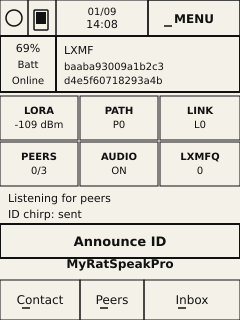
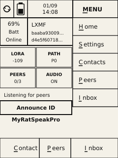
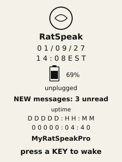
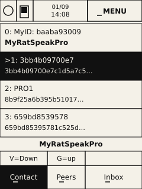
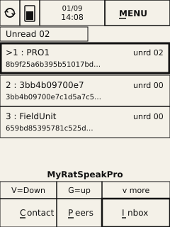
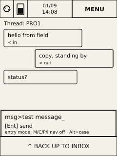
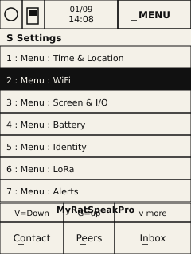
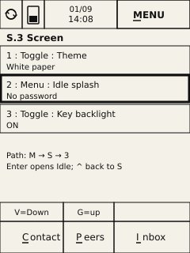

# RatSpeak T-Deck Pro — Navigation & First-Use Guide

**Audience:** operators holding the device, and developers implementing or reworking UI.  
**Input priority:** **keyboard first**; touch is secondary where the panel works.  
**Radio priority:** **LoRa mesh / LXMF first**. WiFi is reserved for later (see TBD).  
**Stable hotkeys:** **I**, **C**, **M**, **P** (do not reassign lightly).

Related code: `StandaloneApp.cpp`, `hal/Keyboard.cpp`, `hal/Power.cpp`, `AI-guide.txt`.

**Wireframes:** schematic 240×320 e-ink layout. Selection = bold outline; MENU underline under **M** only; bottom underlines under **C / P / I**; refresh = dual-arrow cycle.

---

## 1. How to

### 1.1 Typical send a message

1. Wake if idle → any key.  
2. **I** → Inbox *(skip if already on Inbox or in the right thread)*.  
3. Select contact via **touch** or a **number**, then **Enter**.  
4. Type message (**Alt** for case). Nav underlines off.  
5. **Enter** to send.  
6. Optional **^** back to list.

```text
I  →  select  →  type  →  Enter  →  ^ (optional)
```

### 1.2 Add a contact / name a contact

**Discover first (two radios):** on each device, Home → **Announce ID**, then open **Peers** (**P**) and confirm the other appears.

**Name them:**

1. **C** → Contacts *(or **P** Peers if they are not saved yet)*.  
2. Select the new device (touch, **V**/**G**, or digit).  
3. **Enter** to open name edit.  
4. Type the display name (**Alt** for case).  
5. **Enter** to save.

```text
C  →  select new device  →  type name  →  Enter
```

Row **0** is always **this** device (**MyID**). Rename it the same way to set the local display name (default may be **MyRatSpeakPro**).

### 1.3 First-boot setup

Do this on each newly programmed radio before relying on messaging.

| Step | What | How |
|------|------|-----|
| 1 | **Configure time** | **M → S → 1** (Time & Location) → set RTC (**S.1.1**) and timezone (**S.1.2**) |
| 2 | **Display theme** | **M → S → 3** (Screen) → **1** Theme → toggle **White paper** vs **Black ink** |
| 3 | **Name this device** | **C** → row **0 MyID** → type name → **Enter** |
| 4 | **WiFi** | **M → S → 2** — **TBD** (not required for LoRa messaging) |
| 5 | **Meet the other radio** | Announce ID both sides → **P** → name contact (§1.2) → test send (§1.1) |

A **second LoRa RatSpeak device** in range is required to verify messaging.

### 1.4 Install on a fresh T-Deck Pro

**Status: TBD** — refine with your exact PlatformIO env and button labels if they differ.

1. Plug in the **USB** cable (data-capable).  
2. Enter download / bootloader mode:  
   - **Press and hold** the **upper** button (often labeled *BOOT* / track toward top of unit).  
   - **Press and release** the **lower** side button (*RST* / reset).  
   - **Release** the upper button.  
3. Host should see a serial port (e.g. `COMx` on Windows).  
4. Send the firmware over USB, e.g.:

```text
pio run -e tdeck_pro_standalone -t upload --upload-port COMx
```

5. After reset, confirm boot splash → Home. Continue with **§1.3**.

*Do not put a fixed COM port in `platformio.ini` for day-to-day flashes — use `--upload-port` so builds stay incremental.*

---

## 2. Physical controls (summary)

| Key | Browse mode | Entry mode (typing) |
|-----|-------------|---------------------|
| **I** | Inbox | Types letter / no jump |
| **C** | Contacts | Types letter / no jump |
| **P** | Peers | Types letter / no jump |
| **M** | MENU overlay | No jump |
| **S** | Via MENU: **M** then **S** | — |
| **G** / **V** | Up / down lists | — |
| **Enter** | Open / activate | Send / save |
| **Alt** | — | Uppercase ↔ lowercase |
| **SYM** | — | Digits on settings fields |
| **Shift /^** | Back | Back / dismiss |

**Bottom tabs (almost always in browse mode):** Contact **C** · Peers **P** · Inbox **I**.  
**Settings** is not a bottom tab → **M → S**.

---

## 3. Navigation model

**Browse:** hotkeys and underlines active; **G/V** move; digits select (Settings often activates).  
**Entry:** compose or field focused — **M/C/P/I** do not navigate; **Alt** changes case.  
**MENU overlay:** **M** opens column under MENU (**H/S/C/P/I**); top bar stays visible.  
**Scroll:** **v more** / **^ more** only when more rows exist.

---

## 4. Screen map & wireframes

### Wireframe conventions

- **Refresh** (top-left): dual arrows in a cycle (not a plain circle).
- **MENU**: underline under **M** only.
- **Bottom tabs**: underline under **C**, **P**, and **I**.
- **Selection**: bold outline (not inverted fill).
- **Device name**: under Announce on Home; just above G/V footer on list screens; **not** on Settings.

### 4.1 Home



- Status tiles, **Announce ID**, device name below Announce.
- Bottom **Contact | Peers | Inbox**.

### 4.2 Home with MENU overlay



- Same Home background as §4.1.
- Overlay column under **MENU** covers the right side, including the **Announce** area.
- Rows: **H**ome · **S**ettings · **C**ontacts · **P**eers · **I**nbox.
- Top bar stays visible. **M** again closes, or press a letter to jump.

### 4.3 Idle splash



- RatSpeak logo, time, battery, **NEW messages: 3 unread** (example), uptime, name.
- **press a KEY to wake** (touch does not wake).

### 4.4 Contacts



- **0: MyID** = this radio. Selection = bold outline.

### 4.5 Inbox (list)



### 4.6 Inbox thread (typing)



- Entry mode; footer **^ BACK UP TO INBOX**.

### 4.7 Settings root (`S`)



- Open **M → S**. No device-name strip.

### 4.8 Settings **S.3 Screen**



- Theme, Idle splash, Key backlight.
- Bottom chrome matches other list screens (**V/G** footer + **C/P/I** tabs).


---

## 5. Settings tree (`S.*`)

```
S     Settings          ← M then S
├── S.1     Time & Location
│   ├── S.1.1   Set RTC
│   ├── S.1.2   Time zone
│   ├── S.1.3   Enable GPS
│   ├── S.1.4   Manual location
│   └── …       Sync GPS now
├── S.2     WiFi                    [TBD]
├── S.3     Screen & I/O
│   ├── S.3.1   Theme (white / black)
│   ├── S.3.2   Idle splash (+ S.3.2.4 timeout)
│   └── S.3.3   Key backlight
├── S.4     Battery (+ S.4.8 bat log)
├── S.5     Identity
├── S.6     LoRa
├── S.7     Alerts
├── S.8     Diagnostics
└── S.9     Storage (+ S.9.5 SD)
```

---

## 6. Idle & notifications

| Topic | Behavior |
|-------|----------|
| Timeout | **S.3.2** / **S.3.2.4** |
| Wake | Any **key** |
| Unread on splash | May update on RX without leaving idle |
| Beep / vibe | **S.7** when enabled |

---

## 7. Stable hotkey policy

**I / C / M / P** must stay. **S** is reached via **M → S**. **Alt** = case in entry mode.

---

## 8. Implementer checklist

1. Browse vs entry gates **I/C/M/P**.  
2. Underlines only when the action works.  
3. Bottom **C/P/I** in browse mode on main screens.  
4. Settings: **M → S**.  
5. Idle: key wake only.  
6. Announce never implies private-key export.  
7. HAL detail: `hal/` + `AI-guide.txt`.

---

## 9. Document history

| Ver | Notes |
|-----|--------|
| 0.1 | Initial draft: How-to first, screen wireframes, Settings tree, LoRa-first bring-up |

